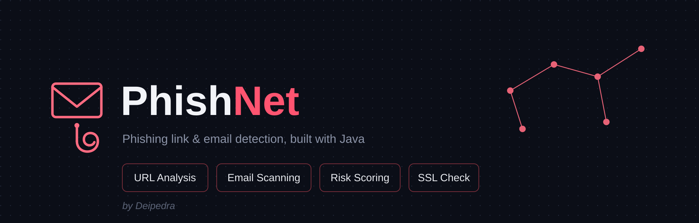
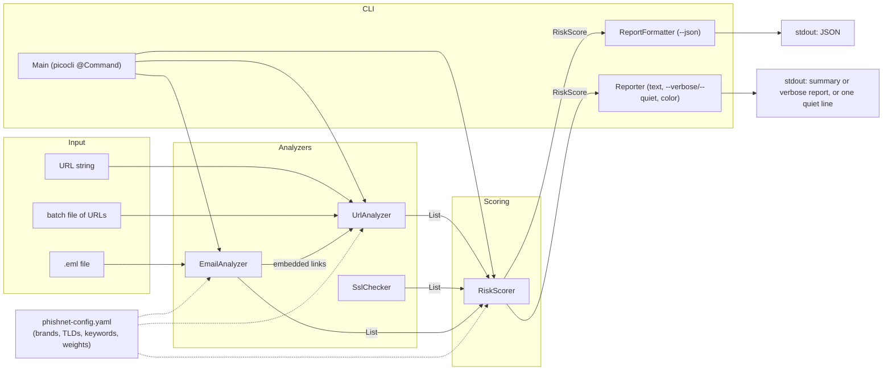

# PhishNet Detector

[](https://github.com/Deipedra34/PhishNet-Detector/actions/workflows/ci.yml)

<p align="center">
  
</p>

A phishing detection tool written in Java. It inspects URLs, TLS certificates,
and `.eml` email files for a range of phishing indicators, then combines
whatever it finds into a single 0-100 risk score with a Low/Medium/High
label and a plain-language recommendation.

Everything that can be tuned - the brand list, suspicious TLDs, urgency
keywords, and scoring weights - lives in a YAML config file, not in the code.

It runs as a command-line tool by default, and can optionally run as a small
JSON REST API server (`phishnet serve`) exposing the same URL and email
scanning over HTTP - see [REST API (serve mode)](#rest-api-serve-mode).
A companion [browser extension](#browser-extension) for Chrome, Edge and
Firefox uses that API to check the page you're on with one click, and
`phishnet monitor` watches a mailbox over IMAP and scans new mail as it
arrives - see [Real-Time Email Monitoring](#real-time-email-monitoring).

An experimental machine-learning layer adds a second opinion next to that
score: a small logistic regression model, trained on a bundled example
dataset, that reports how phishing-like a URL looks ("ML Confidence: 73%
phishing-like"). It's an extra signal only - the rule-based score stays the
authoritative one - and `--no-ml` turns it off. See
[Machine Learning Layer (experimental)](#machine-learning-layer-experimental).

## Contents

- [What it detects](#what-it-detects)
- [Architecture](#architecture)
- [How scoring works](#how-scoring-works)
- [Setup](#setup)
- [Usage](#usage)
- [Scan History](#scan-history)
- [Machine Learning Layer (experimental)](#machine-learning-layer-experimental)
- [REST API (serve mode)](#rest-api-serve-mode)
- [Browser extension](#browser-extension)
- [Real-Time Email Monitoring](#real-time-email-monitoring)
- [Docker](#docker)
- [Configuration](#configuration)
- [Testing](#testing)
- [Project layout](#project-layout)
- [Contributing](#contributing)
- [License](#license)

## What it detects

**URLs** (`UrlAnalyzer`)

- Homograph / punycode attacks (e.g. Cyrillic look-alike characters spoofing `apple.com`)
- Typosquatting against a configurable brand list, via Levenshtein distance
  (`paypa1.com`), combosquatting (`paypal-secure-login.com`,
  `micros0ft-support.com`), and brand-as-subdomain abuse (`paypal.evil.com`)
- URL shorteners (`bit.ly`, `tinyurl.com`, ...) - flagged as elevated risk since they hide the real destination
- Suspicious/abused TLDs (`.tk`, `.ml`, `.ga`, ...), loaded from config
- IP-address-as-domain URLs (`http://192.168.1.1/login`)
- Abnormally long URLs, excessive query parameters, heavy percent-encoding, and nested/embedded redirect URLs

**Domain age** (`DomainAgeChecker`, live WHOIS - disable with `--no-whois`)

- Newly registered domains (under 30 days) and relatively new ones (30-180
  days), via a real-time WHOIS lookup of the URL's registrable domain -
  throwaway phishing domains are typically only days or weeks old
- Well-established domains (over 180 days) get a small score reduction

**TLS certificates** (`SslChecker`)

- No certificate presented at all
- Expired certificates
- Self-signed certificates
- Certificates not issued by a trusted CA

**Emails** (`EmailAnalyzer`, via Jakarta Mail)

- Urgency/threat language, in both English and Turkish (configurable keyword lists)
- Display-name vs. actual sender-address mismatches (spoofing)
- Reply-To/From domain mismatches
- Every embedded link, run back through `UrlAnalyzer`

## Architecture



Each analyzer only *describes what it found* as a list of `Signal` objects
(a stable id, a category, a human-readable description, and optional
evidence). None of them assign point values. `RiskScorer` is the single place
where signal ids are turned into points, summed, clamped to 0-100, and mapped
to a Low/Medium/High band - which is what makes it independently unit
testable and keeps "how risky is X" a one-line config change away from "what
does X look like."

Every analyzer and the scorer take their configuration via constructor
injection (`PhishNetConfig`), and none of them perform their own file or
network I/O internally beyond what their one job requires (`SslChecker`
opens a socket only inside `check()`; its actual decision logic lives in the
network-free `analyze()`; `EmailAnalyzer` and `UrlAnalyzer` operate on
already-supplied streams/strings). That's what lets the test suite exercise
all of the interesting logic with zero real sockets or filesystem access.

The optional REST API (`phishnet serve`) is a second front end over that same
pipeline, not a parallel implementation: `ApiServer` (Javalin) only parses and
validates HTTP input, and `ScanService` calls the exact same `UrlAnalyzer` /
`DomainAgeChecker` / `EmailAnalyzer` / `RiskScorer` sequence the CLI does,
reusing `ReportFormatter`'s JSON structure for its responses.

The experimental ML layer (`com.phishnet.ml`) sits beside `RiskScorer`, not in
front of it: `FeatureExtractor` reads a numeric feature vector off the
`UrlAnalysisResult` and WHOIS result the pipeline already produced, and
`MlScorer` turns that into a probability that `Reporter` prints under the risk
score. Nothing in the rule-based path reads it - see
[Machine Learning Layer (experimental)](#machine-learning-layer-experimental).

## How scoring works

1. Every analyzer run produces a `List<Signal>`, each with a stable id such
   as `homograph`, `typosquatting`, `suspiciousTld`, `sslExpired`,
   `urgencyLanguage`, `senderMismatch`, etc.
2. `RiskScorer` looks up each signal id's point value in
   `scoring.weights` in the config (falling back to 10 points for an
   unrecognized id) and sums them. The same id firing more than once (e.g.
   two risky links in one email) contributes its weight each time.
3. The total is clamped to the 0-100 range.
4. The clamped score is compared against `scoring.mediumThreshold` and
   `scoring.highThreshold` to produce a `RiskLevel` of `LOW`, `MEDIUM`, or
   `HIGH`.
5. A short recommendation string is attached based on the level.

The WHOIS domain age is folded in during step 2: younger than
`scoring.domainAgeNewDays` (30) adds a `domainAgeNew` signal, up to
`scoring.domainAgeRecentDays` (180, inclusive) adds `domainAgeRecent`, and
anything older applies the `domainAgeEstablished` weight (`-5` by default)
without listing it as a signal, since being old isn't a red flag. If the
lookup fails, the age is `unknown` and contributes nothing either way.

Nothing about step 2-4 is hardcoded in Java - every weight and threshold
comes from `phishnet-config.yaml` (or a `--config` override), so retuning the
tool for a stricter or looser environment never requires a rebuild.

## Setup

Requirements: JDK 26+ and Maven 3.9+.

```bash
git clone <this repo>
cd phishnet-detector
mvn clean package
```

This produces a runnable, dependency-bundled jar at `target/phishnet.jar`.

## Usage

The CLI is built on [picocli](https://picocli.info), which generates `--help`
and `--version` output directly from the `@Command`/`@Option` annotations on
[`Main`](src/main/java/com/phishnet/cli/Main.java) - so this is always exactly
what you get by running it yourself:

```
$ java -jar target/phishnet.jar --help
Usage:
phishnet [-hV] [--config=<path>] (--url=<url> | --email=<file.eml> |
         --batch=<file>) [[--json] [--no-color]] [-v | -q]
         [[--history-file=<path>] [--no-history] [--history-db=<path>]
         [--no-history-db]] [[--html-report=<path>]] [[--no-whois]] [[--no-ml]
         [--model=<path>]]

Analyzes URLs, TLS certificates, and .eml email files for phishing indicators,
and combines whatever it finds into a single 0-100 risk score with a
Low/Medium/High label and a plain-language recommendation.

Options:
      --config=<path>        Use a custom YAML config instead of the bundled
                               default
  -h, --help                 Show this help message and exit.
  -V, --version              Print version information and exit.

Input options:
      --url=<url>            Analyze a single URL
      --email=<file.eml>     Analyze a single .eml email file
      --batch=<file>         Analyze a newline-separated file of URLs ('#'
                               comments allowed)

Output options:
      --json                 Output machine-readable JSON instead of a
                               human-readable report
      --no-color             Disable ANSI colors even if the terminal supports
                               them

  -v, --verbose              Show each analyzer's internal reasoning, not just
                               the summary
  -q, --quiet                Print one machine-parsable line only (LEVEL SCORE
                               TARGET); exit code reflects risk

History options:
      --history-file=<path>  Append scan results to this CSV file (default: .
                               /phishnet-history.csv)
      --no-history           Do not append this run's results to the scan
                               history CSV
      --history-db=<path>    Record scan results in this SQLite database
                               (default: ~/.phishnet/phishnet-history.db; query
                               it with: phishnet history)
      --no-history-db        Do not record this run's results in the scan
                               history database

Report options:
      --html-report=<path>   Write a self-contained, styled HTML report of this
                               run's results to <path> (for --batch, written
                               once at the end covering the whole run)

Network options:
      --no-whois             Skip the live WHOIS domain-age lookup (for
                               offline/fast scans or CI); domain age is then
                               left out of the score entirely

Machine learning options (experimental):
      --no-ml                Skip the experimental ML phishing-probability
                               signal entirely; the rule-based risk score is
                               unaffected
      --model=<path>         ML model file, trained from the bundled dataset on
                               first use if missing (default: ~/.
                               phishnet/phishnet-model.json; see: phishnet
                               model --help)

Examples:
  phishnet --url https://example.com
  phishnet --email suspicious.eml --verbose
  phishnet --batch urls.txt --json
  phishnet serve --port 8080   (REST API mode; see: phishnet serve --help)
  phishnet history list        (past scans; see: phishnet history --help)
  phishnet model info          (ML model details; see: phishnet model --help)
  phishnet monitor --help      (watch a mailbox for phishing as mail arrives)

See the project README for the full option reference and sample output.
```

```
$ java -jar target/phishnet.jar --version
phishnet 2.5.0
```

`--version` always reflects the version actually built (Maven filters it into
`version.properties` at build time from the `pom.xml` `<version>`), so it can
never drift out of sync with a release.

Exit codes: `0` for a completed LOW/MEDIUM-risk (or non-quiet) run, `1` for a
completed HIGH-risk run in `--quiet` mode or an I/O error (missing file,
unreadable config), and picocli's own usage-error code (`2`) for bad
arguments - an unknown flag, a missing required value, no (or more than one)
of `--url`/`--email`/`--batch`, or passing both `--verbose` and `--quiet`.

```bash
# Analyze a single URL
java -jar target/phishnet.jar --url "http://paypa1-secure-login.tk/verify?redirect=http://evil.tk/x"

# Analyze a single email
java -jar target/phishnet.jar --email suspicious-message.eml

# Analyze a newline-separated file of URLs ('#' lines are treated as comments).
# On an interactive terminal this shows a live progress bar while scanning
# ("[########------------] 40% (12/30) ETA 0:05", redrawn in place), then
# prints the normal per-item/summary report once scanning finishes.
java -jar target/phishnet.jar --batch urls.txt

# Show each analyzer's internal reasoning (parsed URL/email details), not just the summary
java -jar target/phishnet.jar --url "http://paypa1-secure-login.tk/verify" --verbose

# One machine-parsable line only ("LEVEL SCORE TARGET") - good for piping into other tools.
# Exit code reflects risk too: 1 for HIGH, 0 otherwise, so it's scriptable.
java -jar target/phishnet.jar --url "http://paypa1-secure-login.tk/verify" --quiet

# Machine-readable JSON output, for reporting/CI use
java -jar target/phishnet.jar --url "https://example.com" --json

# Force plain output even on a color-capable terminal
java -jar target/phishnet.jar --url "https://example.com" --no-color

# Use a custom config instead of the bundled defaults
java -jar target/phishnet.jar --url "https://example.com" --config my-config.yaml

# Write scan history somewhere other than ./phishnet-history.csv
java -jar target/phishnet.jar --url "https://example.com" --history-file ~/phishnet-scans.csv

# Don't record this run in the scan history CSV
java -jar target/phishnet.jar --url "https://example.com" --no-history

# Don't record this run in the scan history database (see Scan History below)
java -jar target/phishnet.jar --url "https://example.com" --no-history-db

# Query past scans
java -jar target/phishnet.jar history list

# Write a self-contained HTML report of this run's results
java -jar target/phishnet.jar --batch urls.txt --html-report scan-report.html

# Offline/fast scan: skip the WHOIS domain-age lookup entirely
java -jar target/phishnet.jar --batch urls.txt --no-whois

# Leave out the experimental ML confidence line (see Machine Learning Layer below)
java -jar target/phishnet.jar --url "https://example.com" --no-ml

# Retrain the ML model, or show what the current one was trained on
java -jar target/phishnet.jar model train
java -jar target/phishnet.jar model info

# Watch a mailbox and scan new mail as it arrives (see Real-Time Email Monitoring)
java -jar target/phishnet.jar monitor --host imap.gmail.com --username you@gmail.com --ssl
```

Output is colored automatically when stdout is a real terminal (HIGH=red, MEDIUM=yellow, LOW=green,
bold labels, ⚠/✓/✗ symbols). Colors are skipped automatically when output is piped or redirected to
a file, and can be turned off explicitly with `--no-color` or by setting the `NO_COLOR` environment
variable ([no-color.org](https://no-color.org/)). `--quiet` output never includes color, since it's
meant to be machine-parsable.

### Batch progress

`--batch` on a multi-URL file shows a live progress bar while scanning, redrawn in place on a
single line (`\r`, not one line per update) with a count, a bar, and an ETA once it has enough
data to estimate one:

```
[########------------] 40% (12/30) ETA 0:05
```

It respects the other output modes instead of fighting them:

- Default / `--verbose`: the bar shows during scanning, then the normal per-item/summary report
  prints afterwards - scanning and printing are already separate phases, so the bar never lands
  in the middle of a report line.
- `--quiet`: no progress bar at all, since quiet output must stay strictly one machine-parsable
  line per result.
- `--json`: no progress bar on stdout, so it can never corrupt piped JSON - it renders to stderr
  instead.
- `--no-color`: plain ASCII, no ANSI color/cursor codes.
- Piped/redirected stdout (not a real terminal): the bar is skipped entirely, using the same
  TTY detection as `--no-color`, since redrawing a line makes no sense outside an interactive
  terminal.

### Domain age (WHOIS)

For every `--url` and `--batch` URL, PhishNet looks up when the URL's
registrable domain (e.g. `example.com` for `login.example.com`) was
registered, using a small built-in WHOIS client (plain TCP port 43, no extra
dependencies). The registry server comes from a built-in table for
`.com`/`.net`/`.org`/`.uk`, or from an IANA referral (`whois.iana.org`) for
other TLDs; thin registries' registrar referrals are followed once. Creation
dates are parsed from the common registry formats (`Creation Date:`,
`created:`, `Registered on:`, `Registration Time:`, `Created on...:`,
JPRS `[Created on]`, ...).

```
Domain Age: 12 days                                                          # default output
Domain Age: 12 days (12 days, created 2026-09-12, via whois.verisign-grs.com)  # --verbose
Domain Age: unknown                                                          # lookup failed
```

- Not shown in `--quiet` mode. IP-address hosts have no domain and are
  skipped. `.eml` scans don't do WHOIS lookups.
- A lookup never fails a scan: timeouts, unreachable servers, rate limiting,
  or unparseable replies all produce `Domain Age: unknown` (the reason shows
  in `--verbose`), and the score stays neutral.
- Each lookup has a 5-second total budget. Within a run, results are cached
  per domain and a server that failed isn't retried, so a large batch can't
  stall on one slow registry.
- `--no-whois` turns lookups off completely (offline use, fast scans, CI).

### Scan history CSV

Every scan appends one row to a CSV history file as a side effect - single
`--url`, single `--email`, and each item of a `--batch` run (written
incrementally, one row per item, so an interrupted batch still leaves partial
history). This happens regardless of `--verbose`/`--quiet`/`--json` mode.

- Default location: `./phishnet-history.csv`, relative to the current working
  directory. Override it with `--history-file <path>`.
- `--no-history` disables logging for that run.
- Scans are also recorded in a queryable SQLite database, independently of
  this file - see [Scan History](#scan-history).
- The file is created with a header row on first use; later runs append without
  rewriting the header.
- If the history file can't be written (permissions, disk full, ...), a warning
  is printed to stderr and the scan still completes normally.

Columns (RFC 4180 quoting, so targets containing commas or quotes stay in one
field):

| Column | Meaning |
| --- | --- |
| `timestamp` | ISO-8601 instant when the scan was recorded (UTC, e.g. `2026-09-03T19:03:41.036Z`) |
| `target` | the analyzed URL, or the `.eml` file path |
| `type` | `URL` or `EMAIL` |
| `risk_score` | 0-100 integer |
| `risk_label` | `LOW`, `MEDIUM`, or `HIGH` |
| `signals` | semicolon-separated list of the triggered signal ids (empty if none) |
| `domain_age_days` | WHOIS domain age in days, `unknown` if the lookup failed, empty if no lookup was done (`--no-whois`, IP hosts, emails) |

```
$ cat phishnet-history.csv
timestamp,target,type,risk_score,risk_label,signals,domain_age_days
2026-09-03T19:03:41.036Z,http://paypa1-secure-login.tk/verify?redirect=http://evil.tk/x,URL,70,HIGH,suspiciousTld;typosquatting;nestedRedirect,unknown
2026-09-03T19:03:41.425Z,"https://example.com/path?x=1,2",URL,0,LOW,,11363
```

History files created before v1.8.0 have a six-column header. New rows add
the `domain_age_days` column, so start a fresh file (or add the column to
the old header) if you load the CSV into a tool that expects a consistent
column count.

### HTML report

`--html-report <path>` writes a single, self-contained HTML file (inline CSS,
no external assets or CDN links, no JavaScript) summarizing the run - open it
straight in a browser, even offline:

```bash
java -jar target/phishnet.jar --batch urls.txt --html-report scan-report.html
java -jar target/phishnet.jar --url "https://example.com" --html-report scan-report.html
```

It works the same way for a single `--url`/`--email` scan (a one-row report)
and for `--batch` (every item scanned in that run) - it can be combined with
`--json`, `--quiet`, or `--verbose` without changing what those print. For
`--batch`, the report is written once at the end, covering the whole run, not
once per item. The report contains:

- **Header**: tool name and version, the timestamp the scan ran, and the
  total number of items scanned.
- **Summary**: counts and percentages of LOW/MEDIUM/HIGH results.
- **Results table**: one row per scanned item - target (URL or `.eml` path),
  type, risk score, a color-coded risk label (green/yellow/red, matching the
  terminal output's semantics), WHOIS domain age, and the signals that fired for it. Rows are
  sorted HIGH risk first, then MEDIUM, then LOW.

If the output path's parent directory doesn't exist, it's created
automatically. If the report can't be written (permissions, disk full, ...),
a warning is printed to stderr and the scan still completes normally - same
failure handling as the scan history CSV.

### Sample output

```
$ java -jar target/phishnet.jar --url "http://paypa1-secure-login.tk/verify?redirect=http://evil.tk/x"
Target: http://paypa1-secure-login.tk/verify?redirect=http://evil.tk/x
Risk Score: 70/100 (HIGH)
ML Confidence: >99% phishing-like (experimental)
Signals:
  ✗ [suspiciousTld] URL uses a TLD commonly abused for phishing
  ✗ [typosquatting] Domain segment 'paypa1' closely resembles brand 'paypal' (edit distance 1)
  ✗ [nestedRedirect] URL appears to embed another URL in its query string, a common open-redirect phishing pattern
Recommendation: High risk of phishing. Do not click any links, enter credentials, or open attachments. Report and delete.
```

```
$ java -jar target/phishnet.jar --url "http://paypa1-secure-login.tk/verify" --verbose
Target: http://paypa1-secure-login.tk/verify
Risk Score: 50/100 (MEDIUM)
ML Confidence: 99% phishing-like (experimental)
Signals:
  ⚠ [suspiciousTld] URL uses a TLD commonly abused for phishing (.tk)
  ⚠ [typosquatting] Domain segment 'paypa1' closely resembles brand 'paypal' (edit distance 1) (paypa1-secure-login.tk)
Recommendation: Some phishing indicators found. Proceed with caution: verify the sender/domain through a separate trusted channel before interacting.
Details:
  scheme=http, host=paypa1-secure-login.tk, subdomain=, domain=paypa1-secure-login, tld=tk, ip=false
  path=/verify, query params=0
  ml features: url_length=36, special_chars=2, dot_count=1, subdomain_count=0, ip_host=0, brand_distance=1, typosquatting=1, homograph=0, suspicious_tld=1, url_shortener=0, domain_age_days=?, https=0
```

```
$ java -jar target/phishnet.jar --url "http://paypa1-secure-login.tk/verify?redirect=http://evil.tk/x" --quiet
HIGH 70 http://paypa1-secure-login.tk/verify?redirect=http://evil.tk/x
$ echo $?
1
```

```
$ java -jar target/phishnet.jar --url "https://www.google.com" --json
{
  "target" : "https://www.google.com",
  "score" : 0,
  "level" : "LOW",
  "recommendation" : "No strong phishing indicators found. Still verify anything requesting credentials or payment before acting on it.",
  "signals" : [ ]
}
```

```
$ java -jar target/phishnet.jar --batch urls.txt
...
Summary: 10 URL(s) analyzed - 0 high risk, 6 medium risk
```

## Scan History

Alongside the CSV file, every scan is recorded in a local SQLite database that
the `phishnet history` command can list, search, and summarize. That covers
single `--url`/`--email` scans, each item of a `--batch` run, and scans made
through the REST API (`phishnet serve`).

- Default location: `~/.phishnet/phishnet-history.db`, under your home
  directory, so every scan lands in one place whichever directory you run
  from. Override it with `--history-db <path>` - on scans, on `serve`, and on
  `phishnet history` itself.
- The database file and its schema are created automatically on the first
  scan; there is no setup or migration step.
- `--no-history-db` turns it off for one run (or for a whole `serve` process).
  It's independent of `--no-history`, which only affects the CSV - pass both
  to keep no history at all.
- Like the CSV, a database that can't be written (permissions, a locked or
  corrupt file, ...) only prints a warning to stderr; the scan still
  completes normally.

### `phishnet history` commands

```
phishnet history list   [--limit <n>]
phishnet history search [--target <text>] [--risk <level>] [--type <type>]
                        [--since <YYYY-MM-DD>] [--until <YYYY-MM-DD>] [--limit <n>]
phishnet history stats  [--top <n>]
```

| Command | Shows |
| --- | --- |
| `list` | The most recent scans, newest first (default 20; `--limit 0` shows all) |
| `search` | Scans matching every filter given, newest first (default 20; `--limit 0` shows all) |
| `stats` | Total scans, counts by risk level and by type, and the domains with the most MEDIUM/HIGH scans (`--top`, default 10) |

`search` filters can be combined freely:

| Filter | Matches |
| --- | --- |
| `--target <text>` | Case-insensitive substring of the URL, its domain, the email file name, the sender's domain, or the email subject |
| `--risk <level>` | `LOW`, `MEDIUM`, or `HIGH` (case-insensitive) |
| `--type <type>` | `URL` or `EMAIL` (case-insensitive) |
| `--since <YYYY-MM-DD>` | Scans on or after that day (local time) |
| `--until <YYYY-MM-DD>` | Scans on or before that day (local time) |

Every `history` command also takes `--history-db <path>`, `--no-color`, and
the same verbosity flags as a scan: `-v`/`--verbose` adds each scan's domain,
domain age, email subject, and signals; `-q`/`--quiet` prints one
`LEVEL SCORE TARGET` line per scan (the same format as a `--quiet` scan), or a
single `key=value` line for `stats`. Risk levels are colored on a terminal,
following the same rules as scan output.

Reading never creates the database: if it doesn't exist yet, the commands say
so and exit `0`. Exit code `1` means the database couldn't be read, and `2` a
bad argument (an unknown risk level, a malformed date, `--since` after
`--until`, ...).

```
$ java -jar target/phishnet.jar history list --limit 5
ID  TIME              TYPE   SCORE  RISK    TARGET
 8  2026-10-15 19:20  EMAIL     25  LOW     phishing_sender_mismatch.eml
 7  2026-10-15 19:20  URL       50  MEDIUM  http://secure-paypa1.tk/account
 6  2026-10-15 19:20  URL       20  LOW     http://free-prize.tk
 5  2026-10-15 19:20  URL        0  LOW     https://www.paypal.com/signin
 4  2026-10-15 19:20  URL       25  LOW     http://192.168.1.1/login

5 scan(s) shown (database: /home/alice/.phishnet/phishnet-history.db)
```

```
$ java -jar target/phishnet.jar history search --target paypa1 --risk medium --verbose
ID  TIME                 TYPE   SCORE  RISK    TARGET
 7  2026-10-15 19:20:04  URL       50  MEDIUM  http://secure-paypa1.tk/account
    Domain: secure-paypa1.tk
    Signals:
      - [suspiciousTld] URL uses a TLD commonly abused for phishing
      - [typosquatting] Domain segment 'paypa1' closely resembles brand 'paypal' (edit distance 1)

1 scan(s) shown (database: /home/alice/.phishnet/phishnet-history.db)
```

```
$ java -jar target/phishnet.jar history search --risk HIGH --since 2026-10-01 --until 2026-10-31 --quiet
HIGH 70 http://paypa1-login.tk/verify?redirect=http://evil.tk/x
```

```
$ java -jar target/phishnet.jar history stats
Total scans: 8 (2026-10-15 19:20 to 2026-10-15 19:20)
Database: /home/alice/.phishnet/phishnet-history.db

By risk level:
  HIGH    1   12.5%
  MEDIUM  1   12.5%
  LOW     6   75.0%

By type:
  URL     7
  EMAIL   1

Most frequently flagged domains (MEDIUM/HIGH risk):
  1. paypa1-login.tk   1
  2. secure-paypa1.tk  1
```

### Database schema

It's a plain SQLite file with a single `scans` table, so any SQLite tool can
query it directly too (e.g.
`sqlite3 ~/.phishnet/phishnet-history.db "SELECT domain, COUNT(*) FROM scans GROUP BY domain"`).

| Column | Meaning |
| --- | --- |
| `id` | Auto-increment row id (the `ID` column above) |
| `timestamp` | When the scan was recorded: UTC ISO-8601 with millisecond precision, e.g. `2026-10-15T16:20:04.118Z` |
| `type` | `URL` or `EMAIL` |
| `target` | The scanned URL, or the `.eml` file path (for API scans: the uploaded file name, or `raw email`) |
| `domain` | Registrable domain (or IP address) of a URL; the sender's domain for an email. Empty when there isn't one |
| `subject` | Email subject line; empty for URL scans |
| `risk_score` | 0-100 integer |
| `risk_level` | `LOW`, `MEDIUM`, or `HIGH` |
| `signals` | JSON array of the triggered signals, e.g. `[{"id":"typosquatting","description":"Domain segment ..."}]` |
| `domain_age_days` | WHOIS domain age in days; empty when it isn't known (`--no-whois`, failed lookup, IP host, email) |

A connection is opened per scan, so an interrupted `--batch` keeps every row
recorded so far, and a CLI scan and a running `serve` process can safely share
the same file. All queries use bound parameters - search text is never
interpreted as SQL.

## Machine Learning Layer (experimental)

On top of the rule-based scoring engine, PhishNet can show a second, independent
opinion for each scanned URL: a phishing probability from a small machine-learning
classifier.

```
Risk Score: 70/100 (HIGH)
ML Confidence: >99% phishing-like (experimental)
```

**This is a simple, educational implementation, not a production-grade ML
pipeline.** The model is a hand-written logistic regression (plain Java, no ML
framework, no new dependencies) trained on a small bundled dataset of about a
hundred example rows. It will be confidently wrong on URLs unlike anything in
that data, and it has never been validated against a real-world phishing feed.
Treat its number as a talking point, not a verdict.

### An extra signal, not a replacement

The rule-based `Risk Score` and its LOW/MEDIUM/HIGH level are computed exactly as
before and remain the authoritative result: they alone drive the recommendation,
the `--quiet` exit code, `--json` output, scan history (CSV and SQLite), the HTML
report, and the REST API. The ML layer only adds the one `ML Confidence` line to
the human-readable report. Concretely:

- Shown in NORMAL and `--verbose` output for `--url` and `--batch` scans, right
  under the risk score. `--verbose` also prints the feature values it used
  (`ml features: ...`) in the Details section.
- Never shown (and the model is not even loaded) for `--quiet`, `--json`, and
  `--email` scans, or with `--no-ml`.
- A malformed URL gets no ML line - there's nothing to classify.
- Very high or low probabilities are shown as `>99%` / `<1%`; a model trained on
  this little data is never actually certain.

### How it works

1. **Feature extraction** (`FeatureExtractor`). No URL is parsed twice: the
   features are read off what the analyzers already produced - the parsed URL
   components, the signal ids `UrlAnalyzer` raised, and the WHOIS result - into a
   fixed 12-number vector:

   | Feature | Meaning |
   |---|---|
   | `url_length` | Characters in the full URL |
   | `special_chars` | Characters other than letters, digits, `.`, `:` and `/` (e.g. `-` `_` `@` `?` `=` `%`) |
   | `dot_count` | Dots in the host name |
   | `subdomain_count` | Labels before the registrable domain (0 for IP hosts) |
   | `ip_host` | 1 if the host is a raw IP address |
   | `brand_distance` | Smallest edit distance from any `-`/`_` segment of the domain to a configured brand, capped at 10 (`paypal-secure-login` → 0, `paypa1` → 1; a brand's own domain also counts as 10) |
   | `typosquatting`, `homograph`, `suspicious_tld`, `url_shortener` | 1 if that rule-based signal fired |
   | `domain_age_days` | WHOIS domain age; unknown when WHOIS is skipped (`--no-whois`, IP hosts) or fails |
   | `https` | 1 if the scheme is `https` |

2. **Classifier** (`LogisticRegression`). Each feature is standardized using the
   training data's mean and standard deviation, then combined with learned
   weights and squashed through the logistic function into a 0-1 probability.
   An unknown value (like a missing domain age) is treated as the training
   average, so it neither raises nor lowers the score. Training is full-batch
   gradient descent with a small L2 penalty, starting from zero weights with no
   randomness, so the same data always produces the same model.

3. **Model file** (`MlModel`). The learned parameters plus some metadata
   (training time, dataset, example counts, training accuracy) are saved as JSON
   to `~/.phishnet/phishnet-model.json`, next to the scan history database, so
   training only happens once. Use `--model <path>` on a scan to load a different
   file.

The first scan that needs the model trains it from the bundled dataset
(`src/main/resources/training-data.csv`, shipped inside the jar) and saves it -
this takes well under a second. After that, scans just load the file.

### Commands

```
phishnet model train [--data <path>] [--model <path>]
phishnet model info  [--model <path>]
```

- `phishnet model train` retrains from the bundled dataset and overwrites the
  model file. Pass `--data my-data.csv` to train on your own labeled data
  instead.
- `phishnet model info` shows the current model: when it was trained, on which
  dataset and how many examples, its training accuracy, and the learned weight
  for each feature (positive pushes toward phishing, negative toward legitimate).

```
$ java -jar target/phishnet.jar model info
Model file:        /home/me/.phishnet/phishnet-model.json
Algorithm:         logistic regression
Trained:           2026-10-19T18:35:58Z
Training data:     bundled training-data.csv
Dataset size:      123 examples (60 phishing, 63 legitimate)
Training accuracy: 95.1%
Features (12):
  url_length       +0.614
  special_chars    +0.251
  dot_count        -0.032
  subdomain_count  -0.009
  ip_host          +0.875
  brand_distance   -0.771
  typosquatting    +1.050
  homograph        +0.262
  suspicious_tld   +0.630
  url_shortener    +0.817
  domain_age_days  -1.614
  https            -1.166
  (bias)           -0.281
Weights apply to standardized feature values: positive pushes toward phishing, negative toward legitimate.
```

(Training accuracy is measured on the same data the model was trained on, so it
says nothing about how well it generalizes.)

### Training on your own data

`--data` takes a CSV file in the same format as the bundled one:

- A header row naming the columns: every feature from the table above plus
  `label` (`1` = phishing, `0` = legitimate), in any order. Other columns are
  ignored, so you can keep e.g. a notes column.
- One row per example; plain numbers only. Leave `domain_age_days` empty when
  it's unknown.
- Lines starting with `#` and blank lines are skipped.
- At least one phishing and one legitimate row.

```
url_length,special_chars,dot_count,subdomain_count,ip_host,brand_distance,typosquatting,homograph,suspicious_tld,url_shortener,domain_age_days,https,label
39,1,1,0,0,1,1,0,0,0,26,0,1
29,0,2,1,0,10,0,0,0,0,9000,1,0
```

The simplest way to produce rows is to scan URLs with `--verbose` and copy the
`ml features` values.

### Turning it off, and failure handling

- `--no-ml` skips the ML layer entirely for that scan: the model file is not
  read, trained, or written. Like `--no-whois` and `--no-history-db`, it only
  affects that one run.
- The ML layer can never break a scan. A model file that's corrupt, unreadable,
  or from an incompatible version prints one warning to stderr and the scan
  completes without the ML line; `phishnet model train` replaces it. If a
  freshly trained model can't be saved (e.g. a read-only home directory), it's
  still used for that run and trained again next time.

## REST API (serve mode)

`phishnet serve` starts an embedded HTTP server ([Javalin](https://javalin.io),
on Jetty) that exposes the scanner as a JSON API, for integrating PhishNet into
other services, mail pipelines, or uptime-monitored deployments. It's purely
additive: without `serve`, the tool is the same CLI described above.

```bash
# Default port 8080
java -jar target/phishnet.jar serve

# Custom port, custom config, no live WHOIS lookups
java -jar target/phishnet.jar serve --port 9090 --config my-config.yaml --no-whois
```

```
$ java -jar target/phishnet.jar serve
2026-10-07 23:16:17 INFO io.javalin.Javalin - Starting Javalin ...
2026-10-07 23:16:17 INFO io.javalin.Javalin - Javalin started in 220ms \o/
2026-10-07 23:16:17 INFO io.javalin.Javalin - Listening on http://localhost:8080/
2026-10-07 23:16:17 INFO io.javalin.Javalin - You are running Javalin 7.2.3 (released August 11, 2026).
PhishNet API listening on http://localhost:8080 (Ctrl+C to stop)
  GET  /api/health
  POST /api/scan/url
  POST /api/scan/email
Recording scans to /home/alice/.phishnet/phishnet-history.db
```

| Option | Meaning |
| --- | --- |
| `--port <port>` | TCP port to listen on (default `8080`; `0` picks a free port) |
| `--config <path>` | Use a custom YAML config instead of the bundled default (same as the CLI) |
| `--no-whois` | Skip the live WHOIS domain-age lookup for URL scans (same as the CLI) |
| `--history-db <path>` | Record API scans in this SQLite database (default `~/.phishnet/phishnet-history.db`, same as the CLI) |
| `--no-history-db` | Don't record API scans in the scan history database |

The server runs until stopped with Ctrl+C (or SIGTERM), which shuts it down
cleanly. Exit code `2` means a bad option (e.g. an out-of-range port), `1`
means the config couldn't be loaded or the port couldn't be bound.

### Endpoints

| Method | Path | Request | Response |
| --- | --- | --- | --- |
| `GET` | `/api/health` | - | `{"status":"ok"}` |
| `POST` | `/api/scan/url` | JSON `{"url": "..."}` | URL scan result |
| `POST` | `/api/scan/email` | multipart upload of a `.eml` file in form field `file`, **or** JSON `{"raw": "<full email source>"}` | email scan result |

Every scan result has the same core fields as the CLI's `--json` output -
`target`, `score` (0-100), `level` (`LOW`/`MEDIUM`/`HIGH`), `recommendation`,
and `signals` (each with `id`, `category`, `description`, `evidence`) - plus a
`type` (`URL` or `EMAIL`) and type-specific details:

- URL scans add `domainAge`: `status` is `KNOWN` (with `domain`,
  `creationDate`, `ageDays`, a human-readable `age`, and `whoisServer`),
  `UNKNOWN` (lookup failed; with `domain` and `reason`), or `SKIPPED` (no
  lookup: `--no-whois` or an IP-address host).
- Email scans add `email`: `from`, `displayName`, `replyTo`, `subject`, and
  the embedded `links` that were analyzed.

#### `GET /api/health`

```bash
curl http://localhost:8080/api/health
```

```json
{
  "status": "ok"
}
```

#### `POST /api/scan/url`

```bash
curl -X POST http://localhost:8080/api/scan/url \
  -H "Content-Type: application/json" \
  -d '{"url": "http://paypa1-secure-login.tk/verify?redirect=http://evil.tk/x"}'
```

```json
{
  "target": "http://paypa1-secure-login.tk/verify?redirect=http://evil.tk/x",
  "type": "URL",
  "score": 70,
  "level": "HIGH",
  "recommendation": "High risk of phishing. Do not click any links, enter credentials, or open attachments. Report and delete.",
  "signals": [
    {
      "id": "suspiciousTld",
      "category": "URL",
      "description": "URL uses a TLD commonly abused for phishing",
      "evidence": ".tk"
    },
    {
      "id": "typosquatting",
      "category": "URL",
      "description": "Domain segment 'paypa1' closely resembles brand 'paypal' (edit distance 1)",
      "evidence": "paypa1-secure-login.tk"
    },
    {
      "id": "nestedRedirect",
      "category": "URL",
      "description": "URL appears to embed another URL in its query string, a common open-redirect phishing pattern",
      "evidence": ""
    }
  ],
  "domainAge": {
    "status": "UNKNOWN",
    "domain": "paypa1-secure-login.tk",
    "reason": "WHOIS lookup timed out"
  }
}
```

With a successful WHOIS lookup, `domainAge` carries the registration details:

```bash
curl -X POST http://localhost:8080/api/scan/url \
  -H "Content-Type: application/json" \
  -d '{"url": "https://github.com/login"}'
```

```json
{
  "target": "https://github.com/login",
  "type": "URL",
  "score": 0,
  "level": "LOW",
  "recommendation": "No strong phishing indicators found. Still verify anything requesting credentials or payment before acting on it.",
  "signals": [],
  "domainAge": {
    "status": "KNOWN",
    "domain": "github.com",
    "creationDate": "2007-10-09",
    "ageDays": 6938,
    "age": "18 years",
    "whoisServer": "whois.verisign-grs.com"
  }
}
```

#### `POST /api/scan/email` - `.eml` file upload

```bash
curl -X POST http://localhost:8080/api/scan/email \
  -F "file=@suspicious.eml"
```

```json
{
  "target": "suspicious.eml",
  "type": "EMAIL",
  "score": 25,
  "level": "LOW",
  "recommendation": "No strong phishing indicators found. Still verify anything requesting credentials or payment before acting on it.",
  "signals": [
    {
      "id": "senderMismatch",
      "category": "EMAIL",
      "description": "Display name references brand 'paypal' but sender address domain does not match",
      "evidence": "PayPal Security <alert@random-mailer.info>"
    }
  ],
  "email": {
    "from": "alert@random-mailer.info",
    "displayName": "PayPal Security",
    "replyTo": "alert@random-mailer.info",
    "subject": "Account Alert",
    "links": []
  }
}
```

#### `POST /api/scan/email` - raw email text as JSON

```bash
curl -X POST http://localhost:8080/api/scan/email \
  -H "Content-Type: application/json" \
  -d '{"raw": "From: \"PayPal\" <alert@random-mailer.info>\nTo: victim@example.com\nSubject: Verify immediately\n\nYour account will be suspended. Verify immediately: http://192.168.1.1/login\n"}'
```

```json
{
  "target": "raw email",
  "type": "EMAIL",
  "score": 85,
  "level": "HIGH",
  "recommendation": "High risk of phishing. Do not click any links, enter credentials, or open attachments. Report and delete.",
  "signals": [
    {
      "id": "urgencyLanguage",
      "category": "EMAIL",
      "description": "Message uses urgency/threat language typical of phishing",
      "evidence": "[en] your account will be suspended"
    },
    {
      "id": "senderMismatch",
      "category": "EMAIL",
      "description": "Display name references brand 'paypal' but sender address domain does not match",
      "evidence": "PayPal <alert@random-mailer.info>"
    },
    {
      "id": "riskyEmbeddedLink",
      "category": "EMAIL",
      "description": "Embedded link triggered its own risk signals",
      "evidence": "http://192.168.1.1/login"
    },
    {
      "id": "ipAddressHost",
      "category": "URL",
      "description": "URL uses a raw IP address instead of a domain name",
      "evidence": "192.168.1.1"
    }
  ],
  "email": {
    "from": "alert@random-mailer.info",
    "displayName": "PayPal",
    "replyTo": "alert@random-mailer.info",
    "subject": "Verify immediately",
    "links": [
      "http://192.168.1.1/login"
    ]
  }
}
```

### Errors and limits

Every error response is JSON of the form `{"error": "message"}` - internal
details and stack traces are only ever written to the server's own log
(stderr), never sent to the client.

| Status | When |
| --- | --- |
| `200` | Scan completed (whatever the risk level) |
| `400` | Missing, empty, or malformed input: empty body, invalid JSON, a body that isn't a JSON object, missing/empty/non-string `url` or `raw`, a URL over 8192 characters, a multipart request without a `file` field, an empty uploaded file, or an unreadable multipart body |
| `404` / `405` | Unknown path, or wrong HTTP method for a known path |
| `413` | Request body larger than 5 MB |
| `500` | Unexpected internal failure (`{"error": "Internal server error"}`) |

```bash
$ curl -i -X POST http://localhost:8080/api/scan/url -H "Content-Type: application/json" -d '{}'
HTTP/1.1 400 Bad Request
...
{"error":"Missing required field 'url'"}
```

Notes:

- Request bodies (JSON or multipart) are capped at **5 MB**; oversized bodies
  are rejected without being buffered in full.
- API scans are **not** written to the scan-history CSV and don't produce
  HTML reports, but they are recorded in the scan history database (unless
  `--no-history-db` is given), so they show up in `phishnet history` alongside
  CLI scans. WHOIS results are looked up fresh for each request rather than
  cached across requests.
- There is no authentication, and the server listens on all network
  interfaces. Keep it on a trusted network, or put it behind a reverse proxy
  that handles TLS and access control before exposing it more widely.
- Cross-origin (CORS) access is granted to **browser-extension pages only**
  (`chrome-extension://...` and `moz-extension://...` origins), so the
  [browser extension](#browser-extension) can call the API. Those requests get
  an `Access-Control-Allow-Origin` header echoing their origin, and their
  `OPTIONS` preflight is answered with `204`. Ordinary websites get no CORS
  headers - a page open in your browser can't read results from a server on
  your machine - and every other response is unchanged.

## Browser extension

[`browser-extension/`](browser-extension/) contains a small Manifest V3
extension for Chrome, Edge, and Firefox. Click its toolbar icon and it sends
the current tab's URL to your `phishnet serve` instance and shows the result:
the LOW/MEDIUM/HIGH level (green/yellow/red), the score, and the top signals.
It only checks a page when you click the icon - nothing runs in the
background - and the API address (default `http://localhost:8080`, which also
fits the Docker image run with `-p 8080:8080`) is set on its options page.

It's standalone HTML/CSS/JavaScript, not part of the Maven build or the
Docker image: load the folder unpacked into your browser. See
[browser-extension/README.md](browser-extension/README.md) for setup,
settings, permissions, and troubleshooting.

## Real-Time Email Monitoring

`phishnet monitor` connects to a mailbox over IMAP (or POP3) and scans each new
email as it arrives - with the same `EmailAnalyzer` and scoring engine as
`phishnet --email`, so a monitored message gets exactly the result its `.eml`
file would. It's read-only unless you opt in to flagging or moving suspicious
mail.

```bash
# Prompts for the password (input hidden), then watches INBOX until Ctrl+C
java -jar target/phishnet.jar monitor --host imap.gmail.com --username you@gmail.com --ssl

# Headless/scripted: the password comes from the environment instead of a prompt
export PHISHNET_MAIL_PASSWORD='abcd efgh ijkl mnop'   # e.g. a Gmail app password
java -jar target/phishnet.jar monitor --host imap.gmail.com --username you@gmail.com --ssl

# Opt in to changing the mailbox: flag suspicious mail and move it to a "Suspicious" folder
java -jar target/phishnet.jar monitor --host imap.gmail.com --username you@gmail.com --ssl \
  --flag-suspicious --move-to-folder Suspicious
```

```
$ java -jar target/phishnet.jar monitor --host imap.gmail.com --username you@gmail.com --ssl
Password for you@gmail.com on imap.gmail.com:993 (input hidden):
PhishNet is monitoring INBOX on imap.gmail.com:993 (IMAP over TLS) as you@gmail.com
Read-only: the mailbox is never changed. Suspicious mail (MEDIUM and HIGH risk) is reported.
Recording suspicious mail to phishnet-history.csv and /home/you/.phishnet/phishnet-history.db.
Only mail arriving from now on is scanned. Press Ctrl+C to stop.
[09:14:02] Connected. Waiting for new mail (IMAP IDLE - near real time).
[09:15:40] LOW 0/100  From: Alice <alice@example.com>  Subject: Lunch on Friday?
[09:21:07] ✗ HIGH 85/100  From: PayPal <alert@random-mailer.info>  Subject: Verify immediately
  ✗ [urgencyLanguage] Message uses urgency/threat language typical of phishing
  ✗ [senderMismatch] Display name references brand 'paypal' but sender address domain does not match
  ✗ [riskyEmbeddedLink] Embedded link triggered its own risk signals
  ✗ [ipAddressHost] URL uses a raw IP address instead of a domain name
  High risk of phishing. Do not click any links, enter credentials, or open attachments. Report and delete.
  Actions: recorded in scan history
^C[09:30:12] Monitoring stopped. Scanned 2 message(s), 1 suspicious.
```

### How it works

- **New mail only.** On startup PhishNet notes where the mailbox currently ends
  and scans only messages that arrive after that. If the connection drops, it
  picks up where it left off after reconnecting, so mail that arrived in the
  meantime is still scanned, and nothing is scanned twice.
- **IMAP IDLE when available.** If the server supports IDLE (Gmail, Outlook,
  iCloud, Fastmail, Dovecot, ... do), new mail is reported within seconds. The
  IDLE is renewed every 5 minutes so neither the server nor a router drops the
  quiet connection. Without IDLE, PhishNet checks every `--poll-interval`
  seconds (default 60, minimum 5).
- **POP3** (`--protocol pop3`) is supported too, but only as read-only polling
  of INBOX: POP3 has no IDLE, no flags, and no folders, so `--flag-suspicious`,
  `--move-to-folder`, and `--folder` need IMAP. New messages are told apart by
  their UIDL ids, and nothing is ever deleted from the server.
- **Reconnects with backoff.** A dropped connection, timeout, or server error
  never ends the monitor: it waits 2 s, 4 s, 8 s, ... up to 5 minutes between
  attempts, and starts again at 2 s once connected. A **rejected login** is
  the exception - it stops the monitor with exit code 1 instead of retrying,
  since repeated failed logins can get an account locked. So does a `--folder`
  that doesn't exist.
- **What counts as suspicious** is set by `--act-on`: `MEDIUM` (the default)
  or `HIGH`. Suspicious messages are reported with their signals and the
  recommendation, and recorded in the [scan history](#scan-history) - the CSV
  and the SQLite database, under a label like
  `imap://imap.gmail.com/INBOX;UID=4711` plus sender and subject. Add
  `--record-all` to record every scanned message. They show up in
  `phishnet history` like any other email scan.
- Messages larger than 10 MB are analyzed from their first 10 MB, which still
  covers the headers and text, usually leaving out only attachments.
- A message PhishNet can't read is retried twice more, then skipped with a
  warning, so one broken message can't stall monitoring.

### Changing the mailbox (opt-in)

By default the monitor never changes anything: the folder is opened
read-only, and messages are read without setting the `\Seen` flag, so your
unread mail stays unread. Two options change that, for suspicious messages only:

| Option | What it does |
| --- | --- |
| `--flag-suspicious` | Sets the `\Flagged` flag (a star/flag in most mail apps) and, if the server allows custom keywords, the `$Phishing` keyword |
| `--move-to-folder <name>` | Moves the message to that folder, creating the folder at startup if needed |

Moving uses the IMAP `MOVE` command. On a server without it, PhishNet copies
the message and deletes only that original with `UID EXPUNGE`; if the server
supports neither, it copies the message, leaves the original in place, and
says so. It never runs a plain `EXPUNGE`, which would also permanently remove
any other messages you had marked as deleted.

### Options

| Option | Meaning |
| --- | --- |
| `--host <host>` | Mail server (required) |
| `--username <user>` | Login name, usually the email address; or set `PHISHNET_MAIL_USERNAME` |
| `--password` | Prompt for the password with input hidden (see Security notes for the other ways) |
| `--ssl` / `--starttls` / `--allow-plaintext` | Encryption - one is required. `--ssl` is TLS from the start, `--starttls` upgrades a plain connection and refuses to continue if that fails, `--allow-plaintext` is only for a local test server |
| `--port <port>` | Default 993 for IMAP with `--ssl`, 143 without; 995 / 110 for POP3 |
| `--protocol <protocol>` | `imap` (default) or `pop3` |
| `--folder <name>` | IMAP folder to watch (default INBOX) |
| `--oauth2` | Log in with OAuth2 (SASL XOAUTH2); the "password" is an access token |
| `--poll-interval <seconds>` | Polling period when IDLE isn't available (default 60) |
| `--act-on <level>` | Lowest risk level treated as suspicious: `MEDIUM` (default) or `HIGH` |
| `--flag-suspicious`, `--move-to-folder <name>` | Opt-in mailbox changes, above |
| `--record-all` | Record every message in the history, not only suspicious ones |
| `--history-file`, `--no-history`, `--history-db`, `--no-history-db` | Same as for scans |
| `--config <path>` | Custom YAML config, same as for scans |
| `-v` / `-q`, `--no-color` | Verbose (every message's signals, connection attempts) or quiet (one `LEVEL SCORE LABEL` line per message only); same conventions as scans |

Exit codes: `0` after Ctrl+C (or SIGTERM), `1` for a rejected login, a missing
folder, or an unreadable config, `2` for invalid options.

### Common providers

| Provider | Command | Credentials |
| --- | --- | --- |
| Gmail | `--host imap.gmail.com --ssl` | An [app password](https://support.google.com/accounts/answer/185833) (needs 2-Step Verification), or `--oauth2` |
| Outlook.com / Hotmail, Microsoft 365 | `--host outlook.office365.com --ssl` | `--oauth2` with an access token - Microsoft no longer accepts passwords for IMAP |
| iCloud Mail | `--host imap.mail.me.com --ssl` | An [app-specific password](https://support.apple.com/en-us/102654) |
| Yahoo Mail | `--host imap.mail.yahoo.com --ssl` | An app password from Yahoo's account security settings |
| Fastmail | `--host imap.fastmail.com --ssl` | An app password |
| Your own server (Dovecot, ...) | `--host mail.example.com --ssl` (or `--starttls`) | Your mailbox password, or whatever your admin set up |

Gmail and Outlook.com **don't accept your regular account password** for
IMAP. Create an app password (or use OAuth2) - it only grants mail access, and
you can revoke it at any time without changing your real password.

`--oauth2` sends the "password" as an OAuth2 access token. PhishNet doesn't
run the OAuth sign-in flow or refresh tokens for you: get a token with your
provider's tooling and pass it like a password. Access tokens typically expire
after about an hour, and the monitor then stops with a login error, so for a
long-running monitor an app password is the practical choice where the
provider still offers one.

### Security notes

- **The password is never logged or stored.** It isn't accepted as a plain
  command-line argument (`--password=secret` or `--password secret` is rejected
  without repeating the value, since it would end up in your shell history and
  process list). It comes from the hidden prompt or the
  `PHISHNET_MAIL_PASSWORD` environment variable, is only ever sent to the mail
  server, and appears in no output, error message, or history file - the
  history records the mailbox label, sender, subject, and score only.
- An environment variable is readable by other processes running as the same
  user (and by anyone who can inspect the process). On a shared machine,
  prefer the prompt, or a dedicated account with an app password you can revoke.
- **Use app-specific passwords or OAuth2** wherever your provider supports
  them, never your main account password. Only use plain username/password
  IMAP login with a provider and server you trust.
- **Encryption is required by default**: TLS (`--ssl`) or enforced STARTTLS,
  with the server's certificate and host name verified. `--allow-plaintext`
  sends the password readably over the network and is meant only for a mail
  server on your own machine.
- **Read-only by default**, as described above. `--flag-suspicious` and
  `--move-to-folder` are the only options that change the mailbox.
- Subjects and sender names come from whoever sent the mail, so control
  characters (e.g. terminal escape sequences) are stripped before printing.

In Docker, pass the password through the environment without putting it on
the command line - `-e PHISHNET_MAIL_PASSWORD` with no `=value` copies it from
your shell:

```bash
export PHISHNET_MAIL_PASSWORD='abcd efgh ijkl mnop'
docker run --rm -e PHISHNET_MAIL_PASSWORD -v phishnet-history:/home/phishnet/.phishnet \
  ghcr.io/deipedra34/phishnet-detector monitor --host imap.gmail.com --username you@gmail.com --ssl
```

## Docker

A prebuilt multi-arch image (`linux/amd64`, `linux/arm64`) is published to
GitHub Container Registry on every release, so you can run PhishNet without
installing a JDK or Maven:

```bash
docker pull ghcr.io/deipedra34/phishnet-detector:latest
```

When the repository's Docker Hub secrets are configured, the same image is
also pushed to Docker Hub as `<dockerhub-username>/phishnet-detector`, with the
same tags - the examples below work with either name.

The container's entrypoint is `java -jar phishnet.jar`, so everything after
the image name is passed straight to the CLI - `docker run <image> <args>`
behaves exactly like `java -jar target/phishnet.jar <args>`. Running the image
with no arguments prints `--help`.

### Scan mode

```bash
# Analyze a single URL
docker run --rm ghcr.io/deipedra34/phishnet-detector --url https://example.com

# JSON output, skipping the live WHOIS lookup
docker run --rm ghcr.io/deipedra34/phishnet-detector --url https://example.com --json --no-whois

# Analyze a local email or batch file: mount the current directory at /data
# (the container's working directory) and pass paths relative to it
docker run --rm -v "$PWD:/data" ghcr.io/deipedra34/phishnet-detector --email suspicious.eml
docker run --rm -v "$PWD:/data" ghcr.io/deipedra34/phishnet-detector --batch urls.txt
```

Add `-t` (e.g. `docker run --rm -t ...`) for colored output and the live batch
progress bar - without a TTY the output is plain, just like when piping.

The container runs as an unprivileged user (UID/GID `10001`), not root. Scan
history (`phishnet-history.csv`) and HTML reports are written to `/data`; if
that's a mounted directory the container user can't write to, PhishNet prints
a warning and carries on with the scan. Either pass `--no-history`, or run as
your own user so the files land in your directory with your ownership:

```bash
docker run --rm -v "$PWD:/data" --user "$(id -u):$(id -g)" \
  ghcr.io/deipedra34/phishnet-detector --url https://example.com --html-report report.html \
  --history-db phishnet-history.db
```

(An arbitrary `--user` has no writable home directory inside the image, which
is why that example keeps the scan history database in `/data` too.)

### Scan history in a container

The [scan history database](#scan-history) lives at
`/home/phishnet/.phishnet/phishnet-history.db` inside the container, so with
`--rm` it goes away with the container. Mount a named volume there to keep it
across runs - for scans, `serve`, and `history` alike:

```bash
docker run --rm -v phishnet-history:/home/phishnet/.phishnet \
  ghcr.io/deipedra34/phishnet-detector --url https://example.com

docker run --rm -v phishnet-history:/home/phishnet/.phishnet \
  ghcr.io/deipedra34/phishnet-detector history list
```

The [ML layer's](#machine-learning-layer-experimental) model file is saved in the
same directory (`phishnet-model.json`), so that volume keeps it too. Without one,
each container just retrains it from the bundled dataset on its first scan, which
takes well under a second.

### Serve mode

Publish the API port with `-p` (the image exposes `8080`, the default port):

```bash
docker run --rm -p 8080:8080 ghcr.io/deipedra34/phishnet-detector serve --port 8080

# Run in the background on a different host port
docker run -d --name phishnet-api -p 9090:8080 ghcr.io/deipedra34/phishnet-detector serve --no-whois

curl http://localhost:8080/api/health
```

To use a custom config in either mode, mount it and point `--config` at it:

```bash
docker run --rm -p 8080:8080 -v "$PWD/my-config.yaml:/data/my-config.yaml:ro" \
  ghcr.io/deipedra34/phishnet-detector serve --config my-config.yaml
```

`docker stop` sends SIGTERM, which shuts the server down cleanly, the same as
Ctrl+C.

### Tags

| Tag | Meaning |
| --- | --- |
| `latest` | The most recent release |
| `vX.Y.Z` (e.g. `v2.1.1`) | A specific release, matching the git tag and GitHub Release of the same name - pin this for reproducible deployments |

Images are built and pushed by the
[Docker Publish workflow](.github/workflows/docker-publish.yml) whenever a
`v*.*.*` tag is pushed. Publishing to `ghcr.io` needs no setup (it uses the
workflow's built-in `GITHUB_TOKEN`). Docker Hub publishing is optional: add
`DOCKERHUB_USERNAME` and `DOCKERHUB_TOKEN` (a Docker Hub access token) under
Settings > Secrets and variables > Actions to enable it - without them that
step is skipped rather than failing the run.

### Building the image locally

```bash
docker build -t phishnet-detector .
docker run --rm phishnet-detector --url https://example.com
```

The [`Dockerfile`](Dockerfile) is multi-stage: a Maven + JDK 26 stage runs
`mvn clean package` (tests included), and only the resulting jar is copied
into a minimal `eclipse-temurin:26-jre-alpine` runtime image.

## Configuration

`src/main/resources/phishnet-config.yaml` is bundled into the jar and used
by default. Pass `--config <path>` to override it with your own copy - the
schema is:

```yaml
brands: [google, paypal, apple, ...]        # brand names to defend against typosquatting/homograph attacks
suspiciousTlds: [tk, ml, ga, ...]           # TLDs treated as elevated risk
urlShorteners: [bit.ly, tinyurl.com, ...]   # link shorteners, flagged as elevated risk
urgencyKeywords:
  en: ["verify your account", ...]
  tr: ["hesabınızı doğrulayın", ...]
scoring:
  weights:
    homograph: 35
    typosquatting: 30
    # ... one entry per signal id
    domainAgeNew: 30          # WHOIS age < domainAgeNewDays
    domainAgeRecent: 15       # domainAgeNewDays <= age <= domainAgeRecentDays
    domainAgeEstablished: -5  # older; negative = small score reduction (0 to disable)
  mediumThreshold: 30      # score >= this is MEDIUM
  highThreshold: 60        # score >= this is HIGH
  typosquattingMaxDistance: 2
  longUrlThreshold: 75
  maxQueryParams: 8
  encodedCharThreshold: 5
  domainAgeNewDays: 30
  domainAgeRecentDays: 180
```

The bundled config ships with **71 brands** (banking/finance, tech/email,
crypto exchanges, shipping/delivery, Turkish services, and retail) and
**27 suspicious TLDs**. Both lists are plain YAML sequences, so growing
them is a one-line edit - no recompile needed:

```yaml
brands:
  - paypal
  - your-new-brand-here
```

The TLD list reflects free/cheap-to-register TLDs with historically high
spam/phishing abuse rates per public reporting (e.g. Spamhaus's TLD abuse
statistics). It's a heuristic signal, not a hard rule - legitimate sites
can and do use these TLDs, so a `suspiciousTld` match only ever contributes
its configured partial weight to the score (`scoring.weights.suspiciousTld`)
and never triggers a HIGH verdict by itself.

## Testing

```bash
mvn test
```

JUnit 5 tests cover every module (parsing edge cases, internationalized
domain names, malformed/empty input, missing email headers, scoring
boundaries, CLI argument handling, REST API endpoints) with a mix of
hand-built cases and real-world-style fixtures under
`src/test/resources/{urls,emails}`. The API tests (`ApiServerTest`) start a
real server on a random free port and call it over HTTP with the JDK's
`HttpClient`, covering successful URL/email scans, every 400/404/405/413/500
error path, the JSON error shape, and the extension-only CORS rules (headers and
preflight for `chrome-extension://`/`moz-extension://` origins, none for
websites) - still with no external network access.
`HistoryDatabaseTest` covers the SQLite scan history (schema creation, inserts,
listing, target/risk/type/date filters, LIKE-wildcard and SQL-injection-style
search text, stats aggregation, write failures) against a fresh database file
in a JUnit temp directory per test, so the suite never touches your real
`~/.phishnet` history; `HistoryCommandTest` drives `phishnet history` end to end.
The ML layer's tests (`com.phishnet.ml`) check feature extraction against known
URLs, train the classifier on small, obviously separable synthetic data and
assert only directional results (which side of 0.5 a held-out example lands on,
never exact probabilities), cover CSV parsing and model-file validation, and
confirm that a missing model is trained on first use while a corrupt one only
warns; `ModelCommandTest` drives `phishnet model` end to end, and `MainTest`
checks that `--no-ml` never touches the model file. Every one of them uses a model
file in a JUnit temp directory, never `~/.phishnet`.
The mail monitor's tests run without a mail server: `MailMonitorServiceTest`
drives the monitor loop against an in-memory fake mailbox (`FakeMailSource`)
that scripts new mail, failed connects, dropped connections, unreadable and
deleted messages, and rejected logins, checking the scans, the opt-in
flag/move actions, the reconnect backoff, and shutdown;
`MonitorBuildingBlocksTest` checks that a fetched message is analyzed exactly
like the same `.eml` file, the action policy, the backoff, and that connection
settings never contain the password; `MonitorCommandTest` drives
`phishnet monitor` end to end, including password handling and history output.
The IMAP and POP3 connection classes themselves need a real server and aren't
exercised by the suite.
Edge-case coverage includes empty/null/blank/whitespace-only and
special-character-only input, multi-thousand-character URLs, malformed URLs
(missing scheme, invalid characters, multiple `://`, trailing garbage),
punycode/homograph and raw-Unicode domains, malformed/empty/no-header `.eml`
files, exact-boundary risk-score thresholds, and YAML configs with missing
or empty sections (brands, TLDs, weights).

`mvn test` runs [JaCoCo](https://www.jacoco.org/jacoco/) automatically and
generates an HTML report at `target/site/jacoco/index.html` - open that file
in a browser for a line-by-line, package-by-package breakdown. The suite
(510 tests as of this writing) maintains roughly **90% line / 80% branch**
coverage overall; the biggest remaining gaps are `SslChecker`'s real-socket
TLS handshake path and `SocketWhoisClient`'s port-43 I/O, which by design
aren't exercised without a live network connection (the certificate-decision
logic and all WHOIS parsing/lookup logic are covered separately, with fake
data and no sockets).

The default `mvn test` run (and CI) never touches the network. The few
real-WHOIS smoke tests are tagged `network` and excluded by default; run
them explicitly with:

```bash
mvn test -Dgroups=network -DexcludedGroups=none
```

## Project layout

```
src/main/java/com/phishnet/
  analyzer/   UrlAnalyzer, SslChecker, EmailAnalyzer, DomainAgeChecker, WhoisClient, SocketWhoisClient
  model/      Signal, RiskScore, UrlComponents, PhishNetConfig, ...
  scoring/    RiskScorer
  cli/        Main (picocli @Command), ServeCommand, HistoryCommand, ModelCommand, MonitorCommand, ReportFormatter, Reporter, HistoryReporter, MonitorReporter, OutputLevel, HistoryWriter, HtmlReportWriter
  history/    HistoryDatabase (SQLite scan history), HistoryEntry, HistoryFilter, HistoryStats
  ml/         FeatureVector, FeatureExtractor, LogisticRegression, TrainingData, MlModel, MlScorer, MlPrediction (experimental ML layer)
  mail/       MailMonitorService, MailSource, ImapMailSource, Pop3MailSource, MessageConverter, MonitorActions, Backoff, MailServerSettings (mailbox monitoring)
  api/        ApiServer (Javalin routes, validation, JSON errors), ScanService (analyzer/scorer wrapper)
  util/       LevenshteinDistance, HomoglyphUtil, ConfigLoader, AnsiColor, ColorSupport
src/main/resources/phishnet-config.yaml
src/main/resources/training-data.csv  (bundled example dataset for the ML layer)
src/main/resources/simplelogger.properties  (log levels for serve mode)
src/main/resources/version.properties  (Maven-filtered; feeds --version, see Contributing)
src/test/java/...            (mirrors the layout above)
src/test/resources/urls/     phishing_urls.txt, legitimate_urls.txt
src/test/resources/emails/   .eml fixtures (phishing and legitimate)
Dockerfile, .dockerignore    container image (see Docker)
browser-extension/           Chrome/Edge/Firefox extension (see Browser extension)
.github/workflows/           ci.yml, release.yml, docker-publish.yml
```

## Contributing

The CLI's argument parsing lives entirely in
[`Main`](src/main/java/com/phishnet/cli/Main.java) as
[picocli](https://picocli.info) `@Command`/`@Option`/`@ArgGroup` annotations -
there's no hand-rolled parsing to touch. To add a new flag:

1. Add a `@Option`-annotated field (or a `@Parameters` field for a positional
   argument) to `Main`, or to one of its nested option-holder classes
   (`ModeOptions`, `OutputOptions`, `VerbosityOptions`) if it belongs with an
   existing group. Give it a clear `description` - that text becomes the
   `--help` line, and requirement 4/6 in this repo's own history is "the help
   output should stay well-organized," so group new flags with the section
   they logically belong to (input/output/misc) rather than leaving them to
   fall into the default `Options:` bucket.
2. If the new flag must not be combined with an existing one (like
   `--verbose`/`--quiet`), use an `@ArgGroup` with `exclusive = true` rather
   than a manual `if` check - see the existing groups for the pattern, and
   note the caveat in the comment above the `mode` field about required
   groups needing to live at the top level, not nested inside an optional one.
3. Read the new field in `Main.call()` and wire it into the existing
   `runUrl`/`runEmail`/`runBatch` flow (or add a new one, following the same
   shape: take a `PrintStream`, return an exit code, never call
   `System.exit`).
4. Add a test in `MainTest` that drives it through `Main.run(args, out, err)`
   (which internally goes through picocli's `CommandLine#execute`) and
   asserts on the exit code and captured output - not a subprocess test.
5. Re-paste the `--help` output in this README's Usage section (`java -jar
   target/phishnet.jar --help`) so it stays in sync with what `Main` actually
   generates.

The `--version` string is never hand-typed: it's read at runtime from
`src/main/resources/version.properties`, which Maven filters at build time
(see the `<resources>` block in `pom.xml`) to substitute the real
`${project.version}` from `pom.xml`. Bump the version in one place (the
`pom.xml` `<version>`) and `--version` follows automatically.

## License

MIT - see [LICENSE](LICENSE). Copyright (c) 2026 Kadim Birhan.

<p align="center"><em>-by Deipedra</em></p>
