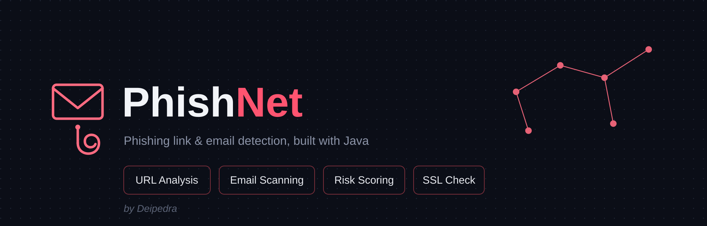
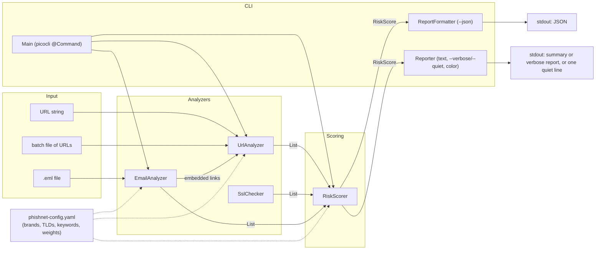

# PhishNet Detector

[](https://github.com/Deipedra34/PhishNet-Detector/actions/workflows/ci.yml)

<p align="center">
  
</p>

A phishing detection tool written in Java. It inspects URLs, TLS certificates,
and `.eml` email files for a range of phishing indicators, then combines
whatever it finds into a single 0-100 risk score with a Low/Medium/High
label and a plain-language recommendation.

Everything that can be tuned - the brand list, suspicious TLDs, urgency
keywords, and scoring weights - lives in a YAML config file, not in the code.

It runs as a command-line tool by default, and can optionally run as a small
JSON REST API server (`phishnet serve`) exposing the same URL and email
scanning over HTTP - see [REST API (serve mode)](#rest-api-serve-mode).
The same server can host a [web dashboard](#web-dashboard) (React) for
scanning, browsing history, and checking stats and feed status in a browser.
A companion [browser extension](#browser-extension) for Chrome, Edge and
Firefox uses that API to check the page you're on with one click, and
`phishnet monitor` watches a mailbox over IMAP and scans new mail as it
arrives - see [Real-Time Email Monitoring](#real-time-email-monitoring).
Batch scans run on several threads at once, and `phishnet queue` can spread a
large list over many worker machines through Redis - see
[Parallel & Distributed Scanning](#parallel--distributed-scanning).

An experimental machine-learning layer adds a second opinion next to that
score: a small logistic regression model, trained on a bundled example
dataset, that reports how phishing-like a URL looks ("ML Confidence: 73%
phishing-like"). It's an extra signal only - the rule-based score stays the
authoritative one - and `--no-ml` turns it off. See
[Machine Learning Layer (experimental)](#machine-learning-layer-experimental).

Every scanned URL is also checked against threat intelligence feeds of known,
confirmed phishing pages (OpenPhish, and PhishTank with an API key), cached
locally and refreshed hourly; a listed URL is flagged as a high-confidence
signal on top of everything else. See
[Threat Intelligence Feeds](#threat-intelligence-feeds).

The CLI, the REST API, the web dashboard, and the browser extension are available
in English and Turkish: `--lang tr`, an `Accept-Language: tr` header, or a language
menu. See [Languages](#languages).

## Contents

- [What it detects](#what-it-detects)
- [Architecture](#architecture)
- [How scoring works](#how-scoring-works)
- [Setup](#setup)
- [Usage](#usage)
- [Scan History](#scan-history)
- [Machine Learning Layer (experimental)](#machine-learning-layer-experimental)
- [Threat Intelligence Feeds](#threat-intelligence-feeds)
- [REST API (serve mode)](#rest-api-serve-mode)
- [Web Dashboard](#web-dashboard)
- [Browser extension](#browser-extension)
- [Real-Time Email Monitoring](#real-time-email-monitoring)
- [Parallel & Distributed Scanning](#parallel--distributed-scanning)
- [Languages](#languages)
- [Docker](#docker)
- [Configuration](#configuration)
- [Testing](#testing)
- [Project layout](#project-layout)
- [Contributing](#contributing)
- [License](#license)

## What it detects

**URLs** (`UrlAnalyzer`)

- Homograph / punycode attacks (e.g. Cyrillic look-alike characters spoofing `apple.com`)
- Typosquatting against a configurable brand list, via Levenshtein distance
  (`paypa1.com`), combosquatting (`paypal-secure-login.com`,
  `micros0ft-support.com`), and brand-as-subdomain abuse (`paypal.evil.com`)
- URL shorteners (`bit.ly`, `tinyurl.com`, ...) - flagged as elevated risk since they hide the real destination
- Suspicious/abused TLDs (`.tk`, `.ml`, `.ga`, ...), loaded from config
- IP-address-as-domain URLs (`http://192.168.1.1/login`)
- Abnormally long URLs, excessive query parameters, heavy percent-encoding, and nested/embedded redirect URLs

**Domain age** (`DomainAgeChecker`, live WHOIS - disable with `--no-whois`)

- Newly registered domains (under 30 days) and relatively new ones (30-180
  days), via a real-time WHOIS lookup of the URL's registrable domain -
  throwaway phishing domains are typically only days or weeks old
- Well-established domains (over 180 days) get a small score reduction

**Known phishing URLs** (`ThreatFeedService`, OpenPhish/PhishTank - disable with `--no-threat-feeds`)

- URLs listed in the OpenPhish and (with an API key) PhishTank feeds of
  confirmed phishing pages, and other pages on a listed host - see
  [Threat Intelligence Feeds](#threat-intelligence-feeds)

**TLS certificates** (`SslChecker`)

- No certificate presented at all
- Expired certificates
- Self-signed certificates
- Certificates not issued by a trusted CA

**Emails** (`EmailAnalyzer`, via Jakarta Mail)

- Urgency/threat language, in both English and Turkish (configurable keyword lists)
- Display-name vs. actual sender-address mismatches (spoofing)
- Reply-To/From domain mismatches
- Every embedded link, run back through `UrlAnalyzer`

## Architecture



Each analyzer only *describes what it found* as a list of `Signal` objects
(a stable id, a category, a human-readable description, and optional
evidence). None of them assign point values. `RiskScorer` is the single place
where signal ids are turned into points, summed, clamped to 0-100, and mapped
to a Low/Medium/High band - which is what makes it independently unit
testable and keeps "how risky is X" a one-line config change away from "what
does X look like."

Every analyzer and the scorer take their configuration via constructor
injection (`PhishNetConfig`), and none of them perform their own file or
network I/O internally beyond what their one job requires (`SslChecker`
opens a socket only inside `check()`; its actual decision logic lives in the
network-free `analyze()`; `EmailAnalyzer` and `UrlAnalyzer` operate on
already-supplied streams/strings). That's what lets the test suite exercise
all of the interesting logic with zero real sockets or filesystem access.

The optional REST API (`phishnet serve`) is a second front end over that same
pipeline, not a parallel implementation: `ApiServer` (Javalin) only parses and
validates HTTP input, and `ScanService` calls the exact same `UrlAnalyzer` /
`DomainAgeChecker` / `EmailAnalyzer` / `RiskScorer` sequence the CLI does,
reusing `ReportFormatter`'s JSON structure for its responses.

Threat intelligence feeds (`com.phishnet.feeds`) are another signal source:
`ThreatFeedService` keeps a local cache of the OpenPhish/PhishTank feeds fresh,
and its `ThreatFeedIndex` turns a feed match into a `knownPhishingUrl` or
`knownPhishingDomain` signal that goes to `RiskScorer` alongside the analyzers'
signals - see [Threat Intelligence Feeds](#threat-intelligence-feeds).

The experimental ML layer (`com.phishnet.ml`) sits beside `RiskScorer`, not in
front of it: `FeatureExtractor` reads a numeric feature vector off the
`UrlAnalysisResult` and WHOIS result the pipeline already produced, and
`MlScorer` turns that into a probability that `Reporter` prints under the risk
score. Nothing in the rule-based path reads it - see
[Machine Learning Layer (experimental)](#machine-learning-layer-experimental).

## How scoring works

1. Every analyzer run produces a `List<Signal>`, each with a stable id such
   as `homograph`, `typosquatting`, `suspiciousTld`, `sslExpired`,
   `urgencyLanguage`, `senderMismatch`, etc.
2. `RiskScorer` looks up each signal id's point value in
   `scoring.weights` in the config (falling back to 10 points for an
   unrecognized id) and sums them. The same id firing more than once (e.g.
   two risky links in one email) contributes its weight each time.
3. The total is clamped to the 0-100 range.
4. The clamped score is compared against `scoring.mediumThreshold` and
   `scoring.highThreshold` to produce a `RiskLevel` of `LOW`, `MEDIUM`, or
   `HIGH`.
5. A short recommendation string is attached based on the level.

The WHOIS domain age is folded in during step 2: younger than
`scoring.domainAgeNewDays` (30) adds a `domainAgeNew` signal, up to
`scoring.domainAgeRecentDays` (180, inclusive) adds `domainAgeRecent`, and
anything older applies the `domainAgeEstablished` weight (`-5` by default)
without listing it as a signal, since being old isn't a red flag. If the
lookup fails, the age is `unknown` and contributes nothing either way.

Threat feed matches arrive in step 1 as one more signal: `knownPhishingUrl`
(70 points) when the URL itself is listed in OpenPhish or PhishTank, or
`knownPhishingDomain` (40) when other URLs on its host are. They add to the
other signals and the domain age like any other weight; a config that predates
them still scores them at those defaults rather than the generic 10.

Nothing about step 2-4 is hardcoded in Java - every weight and threshold
comes from `phishnet-config.yaml` (or a `--config` override), so retuning the
tool for a stricter or looser environment never requires a rebuild.

## Setup

Requirements: JDK 26+ and Maven 3.9+.

```bash
git clone <this repo>
cd phishnet-detector
mvn clean package
```

This produces a runnable, dependency-bundled jar at `target/phishnet.jar`.

## Usage

The CLI is built on [picocli](https://picocli.info), which generates `--help`
and `--version` output from the `@Command`/`@Option` annotations on
[`Main`](src/main/java/com/phishnet/cli/Main.java) and the help text in
[`messages.properties`](src/main/resources/i18n/messages.properties) - so this is
always exactly what you get by running it yourself (in English; `--lang tr` shows it
in Turkish, see [Languages](#languages)):

```
$ java -jar target/phishnet.jar --help

Usage:
phishnet [-hV] [--config=<path>] [--lang=<lang>] (--url=<url> | --email=<file.
         eml> | --batch=<file>) [[--json] [--no-color]] [-v | -q]
         [[--history-file=<path>] [--no-history] [--history-db=<path>]
         [--no-history-db]] [[--html-report=<path>]] [[--no-whois]
         [--no-threat-feeds]] [[--threads=<n>]] [[--no-ml] [--model=<path>]]

Analyzes URLs, TLS certificates, and .eml email files for phishing indicators,
and combines whatever it finds into a single 0-100 risk score with a
Low/Medium/High label and a plain-language recommendation.

Options:
      --config=<path>        Use a custom YAML config instead of the bundled
                               default
      --lang=<lang>          Output language: en or tr (default: the system
                               language if supported, else English)
  -h, --help                 Show this help message and exit.
  -V, --version              Print version information and exit.

Input options:
      --url=<url>            Analyze a single URL
      --email=<file.eml>     Analyze a single .eml email file
      --batch=<file>         Analyze a newline-separated file of URLs ('#'
                               comments allowed)

Output options:
      --json                 Output machine-readable JSON instead of a
                               human-readable report
      --no-color             Disable ANSI colors even if the terminal supports
                               them

  -v, --verbose              Show each analyzer's internal reasoning, not just
                               the summary
  -q, --quiet                Print one machine-parsable line only (LEVEL SCORE
                               TARGET); exit code reflects risk

History options:
      --history-file=<path>  Append scan results to this CSV file (default: .
                               /phishnet-history.csv)
      --no-history           Do not append this run's results to the scan
                               history CSV
      --history-db=<path>    Record scan results in this SQLite database
                               (default: ~/.phishnet/phishnet-history.db; query
                               it with: phishnet history)
      --no-history-db        Do not record this run's results in the scan
                               history database

Report options:
      --html-report=<path>   Write a self-contained, styled HTML report of this
                               run's results to <path> (for --batch, written
                               once at the end covering the whole run)

Network options:
      --no-whois             Skip the live WHOIS domain-age lookup (for
                               offline/fast scans or CI); domain age is then
                               left out of the score entirely
      --no-threat-feeds      Don't check the OpenPhish/PhishTank threat
                               intelligence feeds (no feed downloads, cached
                               feeds unused); feed matches are then left out of
                               the score

Batch options:
      --threads=<n>          Scan --batch URLs on this many threads in parallel
                               (default: one per CPU core; 1 scans them one at
                               a time). Output order is the same either way.

Machine learning options (experimental):
      --no-ml                Skip the experimental ML phishing-probability
                               signal entirely; the rule-based risk score is
                               unaffected
      --model=<path>         ML model file, trained from the bundled dataset on
                               first use if missing (default: ~/.
                               phishnet/phishnet-model.json; see: phishnet
                               model --help)

Examples:
  phishnet --url https://example.com
  phishnet --email suspicious.eml --verbose
  phishnet --batch urls.txt --json
  phishnet serve --port 8080   (REST API mode; see: phishnet serve --help)
  phishnet history list        (past scans; see: phishnet history --help)
  phishnet model info          (ML model details; see: phishnet model --help)
  phishnet monitor --help      (watch a mailbox for phishing as mail arrives)
  phishnet queue --help        (distributed scanning with Redis workers)
  phishnet feeds status        (threat intelligence feeds; see: phishnet feeds
--help)

See the project README for the full option reference and sample output.
```

```
$ java -jar target/phishnet.jar --version
phishnet 2.10.0
```

`--version` always reflects the version actually built (Maven filters it into
`version.properties` at build time from the `pom.xml` `<version>`), so it can
never drift out of sync with a release.

Exit codes: `0` for a completed LOW/MEDIUM-risk (or non-quiet) run, `1` for a
completed HIGH-risk run in `--quiet` mode or an I/O error (missing file,
unreadable config), and picocli's own usage-error code (`2`) for bad
arguments - an unknown flag, a missing required value, no (or more than one)
of `--url`/`--email`/`--batch`, or passing both `--verbose` and `--quiet`.

```bash
# Analyze a single URL
java -jar target/phishnet.jar --url "http://paypa1-secure-login.tk/verify?redirect=http://evil.tk/x"

# Analyze a single email
java -jar target/phishnet.jar --email suspicious-message.eml

# Analyze a newline-separated file of URLs ('#' lines are treated as comments).
# On an interactive terminal this shows a live progress bar while scanning
# ("[########------------] 40% (12/30) ETA 0:05", redrawn in place), then
# prints the normal per-item/summary report once scanning finishes.
java -jar target/phishnet.jar --batch urls.txt

# Show each analyzer's internal reasoning (parsed URL/email details), not just the summary
java -jar target/phishnet.jar --url "http://paypa1-secure-login.tk/verify" --verbose

# One machine-parsable line only ("LEVEL SCORE TARGET") - good for piping into other tools.
# Exit code reflects risk too: 1 for HIGH, 0 otherwise, so it's scriptable.
java -jar target/phishnet.jar --url "http://paypa1-secure-login.tk/verify" --quiet

# Machine-readable JSON output, for reporting/CI use
java -jar target/phishnet.jar --url "https://example.com" --json

# Force plain output even on a color-capable terminal
java -jar target/phishnet.jar --url "https://example.com" --no-color

# Help and results in Turkish (default: the system language, else English; see Languages)
java -jar target/phishnet.jar --url "https://example.com" --lang tr

# Use a custom config instead of the bundled defaults
java -jar target/phishnet.jar --url "https://example.com" --config my-config.yaml

# Write scan history somewhere other than ./phishnet-history.csv
java -jar target/phishnet.jar --url "https://example.com" --history-file ~/phishnet-scans.csv

# Don't record this run in the scan history CSV
java -jar target/phishnet.jar --url "https://example.com" --no-history

# Don't record this run in the scan history database (see Scan History below)
java -jar target/phishnet.jar --url "https://example.com" --no-history-db

# Query past scans
java -jar target/phishnet.jar history list

# Write a self-contained HTML report of this run's results
java -jar target/phishnet.jar --batch urls.txt --html-report scan-report.html

# Offline/fast scan: skip the WHOIS domain-age lookup entirely
java -jar target/phishnet.jar --batch urls.txt --no-whois

# Scan a batch on 16 threads (default: one per CPU core; see Parallel & Distributed Scanning)
java -jar target/phishnet.jar --batch urls.txt --threads 16

# Leave out the experimental ML confidence line (see Machine Learning Layer below)
java -jar target/phishnet.jar --url "https://example.com" --no-ml

# Don't check the OpenPhish/PhishTank threat feeds (see Threat Intelligence Feeds below)
java -jar target/phishnet.jar --url "https://example.com" --no-threat-feeds

# Refresh the threat feed cache now, or show its state
java -jar target/phishnet.jar feeds update
java -jar target/phishnet.jar feeds status

# Retrain the ML model, or show what the current one was trained on
java -jar target/phishnet.jar model train
java -jar target/phishnet.jar model info

# Watch a mailbox and scan new mail as it arrives (see Real-Time Email Monitoring)
java -jar target/phishnet.jar monitor --host imap.gmail.com --username you@gmail.com --ssl
```

Output is colored automatically when stdout is a real terminal (HIGH=red, MEDIUM=yellow, LOW=green,
bold labels, ⚠/✓/✗ symbols). Colors are skipped automatically when output is piped or redirected to
a file, and can be turned off explicitly with `--no-color` or by setting the `NO_COLOR` environment
variable ([no-color.org](https://no-color.org/)). `--quiet` output never includes color, since it's
meant to be machine-parsable.

### Batch progress

`--batch` on a multi-URL file shows a live progress bar while scanning, redrawn in place on a
single line (`\r`, not one line per update) with a count, a bar, and an ETA once it has enough
data to estimate one:

```
[########------------] 40% (12/30) ETA 0:05
```

It respects the other output modes instead of fighting them:

- With `--threads` above 1 (the default on multi-core machines), URLs finish out of order; the
  bar counts each one as it finishes, so it stays accurate, and the report still lists them in
  input order.
- Default / `--verbose`: the bar shows during scanning, then the normal per-item/summary report
  prints afterwards - scanning and printing are already separate phases, so the bar never lands
  in the middle of a report line.
- `--quiet`: no progress bar at all, since quiet output must stay strictly one machine-parsable
  line per result.
- `--json`: no progress bar on stdout, so it can never corrupt piped JSON - it renders to stderr
  instead.
- `--no-color`: plain ASCII, no ANSI color/cursor codes.
- Piped/redirected stdout (not a real terminal): the bar is skipped entirely, using the same
  TTY detection as `--no-color`, since redrawing a line makes no sense outside an interactive
  terminal.

### Domain age (WHOIS)

For every `--url` and `--batch` URL, PhishNet looks up when the URL's
registrable domain (e.g. `example.com` for `login.example.com`) was
registered, using a small built-in WHOIS client (plain TCP port 43, no extra
dependencies). The registry server comes from a built-in table for
`.com`/`.net`/`.org`/`.uk`, or from an IANA referral (`whois.iana.org`) for
other TLDs; thin registries' registrar referrals are followed once. Creation
dates are parsed from the common registry formats (`Creation Date:`,
`created:`, `Registered on:`, `Registration Time:`, `Created on...:`,
JPRS `[Created on]`, ...).

```
Domain Age: 12 days                                                          # default output
Domain Age: 12 days (12 days, created 2026-09-12, via whois.verisign-grs.com)  # --verbose
Domain Age: unknown                                                          # lookup failed
```

- Not shown in `--quiet` mode. IP-address hosts have no domain and are
  skipped. `.eml` scans don't do WHOIS lookups.
- A lookup never fails a scan: timeouts, unreachable servers, rate limiting,
  or unparseable replies all produce `Domain Age: unknown` (the reason shows
  in `--verbose`), and the score stays neutral.
- Each lookup has a 5-second total budget. Within a run, results are cached
  per domain and a server that failed isn't retried, so a large batch can't
  stall on one slow registry.
- `--no-whois` turns lookups off completely (offline use, fast scans, CI).

### Scan history CSV

Every scan appends one row to a CSV history file as a side effect - single
`--url`, single `--email`, and each item of a `--batch` run (written
incrementally, one row per item, so an interrupted batch still leaves partial
history). This happens regardless of `--verbose`/`--quiet`/`--json` mode.

- Default location: `./phishnet-history.csv`, relative to the current working
  directory. Override it with `--history-file <path>`.
- `--no-history` disables logging for that run.
- Scans are also recorded in a queryable SQLite database, independently of
  this file - see [Scan History](#scan-history).
- The file is created with a header row on first use; later runs append without
  rewriting the header.
- If the history file can't be written (permissions, disk full, ...), a warning
  is printed to stderr and the scan still completes normally.

Columns (RFC 4180 quoting, so targets containing commas or quotes stay in one
field):

| Column | Meaning |
| --- | --- |
| `timestamp` | ISO-8601 instant when the scan was recorded (UTC, e.g. `2026-09-03T19:03:41.036Z`) |
| `target` | the analyzed URL, or the `.eml` file path |
| `type` | `URL` or `EMAIL` |
| `risk_score` | 0-100 integer |
| `risk_label` | `LOW`, `MEDIUM`, or `HIGH` |
| `signals` | semicolon-separated list of the triggered signal ids (empty if none) |
| `domain_age_days` | WHOIS domain age in days, `unknown` if the lookup failed, empty if no lookup was done (`--no-whois`, IP hosts, emails) |

```
$ cat phishnet-history.csv
timestamp,target,type,risk_score,risk_label,signals,domain_age_days
2026-09-03T19:03:41.036Z,http://paypa1-secure-login.tk/verify?redirect=http://evil.tk/x,URL,70,HIGH,suspiciousTld;typosquatting;nestedRedirect,unknown
2026-09-03T19:03:41.425Z,"https://example.com/path?x=1,2",URL,0,LOW,,11363
```

History files created before v1.8.0 have a six-column header. New rows add
the `domain_age_days` column, so start a fresh file (or add the column to
the old header) if you load the CSV into a tool that expects a consistent
column count.

### HTML report

`--html-report <path>` writes a single, self-contained HTML file (inline CSS,
no external assets or CDN links, no JavaScript) summarizing the run - open it
straight in a browser, even offline:

```bash
java -jar target/phishnet.jar --batch urls.txt --html-report scan-report.html
java -jar target/phishnet.jar --url "https://example.com" --html-report scan-report.html
```

It works the same way for a single `--url`/`--email` scan (a one-row report)
and for `--batch` (every item scanned in that run) - it can be combined with
`--json`, `--quiet`, or `--verbose` without changing what those print. For
`--batch`, the report is written once at the end, covering the whole run, not
once per item. The report contains:

- **Header**: tool name and version, the timestamp the scan ran, and the
  total number of items scanned.
- **Summary**: counts and percentages of LOW/MEDIUM/HIGH results.
- **Results table**: one row per scanned item - target (URL or `.eml` path),
  type, risk score, a color-coded risk label (green/yellow/red, matching the
  terminal output's semantics), WHOIS domain age, and the signals that fired for it. Rows are
  sorted HIGH risk first, then MEDIUM, then LOW.

If the output path's parent directory doesn't exist, it's created
automatically. If the report can't be written (permissions, disk full, ...),
a warning is printed to stderr and the scan still completes normally - same
failure handling as the scan history CSV.

### Sample output

```
$ java -jar target/phishnet.jar --url "http://paypa1-secure-login.tk/verify?redirect=http://evil.tk/x"
Target: http://paypa1-secure-login.tk/verify?redirect=http://evil.tk/x
Risk Score: 70/100 (HIGH)
ML Confidence: >99% phishing-like (experimental)
Signals:
  ✗ [suspiciousTld] URL uses a TLD commonly abused for phishing
  ✗ [typosquatting] Domain segment 'paypa1' closely resembles brand 'paypal' (edit distance 1)
  ✗ [nestedRedirect] URL appears to embed another URL in its query string, a common open-redirect phishing pattern
Recommendation: High risk of phishing. Do not click any links, enter credentials, or open attachments. Report and delete.
```

```
$ java -jar target/phishnet.jar --url "http://paypa1-secure-login.tk/verify" --verbose
Target: http://paypa1-secure-login.tk/verify
Risk Score: 50/100 (MEDIUM)
ML Confidence: 99% phishing-like (experimental)
Signals:
  ⚠ [suspiciousTld] URL uses a TLD commonly abused for phishing (.tk)
  ⚠ [typosquatting] Domain segment 'paypa1' closely resembles brand 'paypal' (edit distance 1) (paypa1-secure-login.tk)
Recommendation: Some phishing indicators found. Proceed with caution: verify the sender/domain through a separate trusted channel before interacting.
Details:
  scheme=http, host=paypa1-secure-login.tk, subdomain=, domain=paypa1-secure-login, tld=tk, ip=false
  path=/verify, query params=0
  ml features: url_length=36, special_chars=2, dot_count=1, subdomain_count=0, ip_host=0, brand_distance=1, typosquatting=1, homograph=0, suspicious_tld=1, url_shortener=0, domain_age_days=?, https=0
```

```
$ java -jar target/phishnet.jar --url "http://paypa1-secure-login.tk/verify?redirect=http://evil.tk/x" --quiet
HIGH 70 http://paypa1-secure-login.tk/verify?redirect=http://evil.tk/x
$ echo $?
1
```

```
$ java -jar target/phishnet.jar --url "https://www.google.com" --json
{
  "target" : "https://www.google.com",
  "score" : 0,
  "level" : "LOW",
  "recommendation" : "No strong phishing indicators found. Still verify anything requesting credentials or payment before acting on it.",
  "signals" : [ ]
}
```

```
$ java -jar target/phishnet.jar --batch urls.txt
...
Summary: 10 URL(s) analyzed - 0 high risk, 6 medium risk
```

## Scan History

Alongside the CSV file, every scan is recorded in a local SQLite database that
the `phishnet history` command can list, search, and summarize. That covers
single `--url`/`--email` scans, each item of a `--batch` run, and scans made
through the REST API (`phishnet serve`).

- Default location: `~/.phishnet/phishnet-history.db`, under your home
  directory, so every scan lands in one place whichever directory you run
  from. Override it with `--history-db <path>` - on scans, on `serve`, and on
  `phishnet history` itself.
- The database file and its schema are created automatically on the first
  scan; there is no setup or migration step.
- `--no-history-db` turns it off for one run (or for a whole `serve` process).
  It's independent of `--no-history`, which only affects the CSV - pass both
  to keep no history at all.
- Like the CSV, a database that can't be written (permissions, a locked or
  corrupt file, ...) only prints a warning to stderr; the scan still
  completes normally.

### `phishnet history` commands

```
phishnet history list   [--limit <n>]
phishnet history search [--target <text>] [--risk <level>] [--type <type>]
                        [--since <YYYY-MM-DD>] [--until <YYYY-MM-DD>] [--limit <n>]
phishnet history stats  [--top <n>]
```

| Command | Shows |
| --- | --- |
| `list` | The most recent scans, newest first (default 20; `--limit 0` shows all) |
| `search` | Scans matching every filter given, newest first (default 20; `--limit 0` shows all) |
| `stats` | Total scans, counts by risk level and by type, and the domains with the most MEDIUM/HIGH scans (`--top`, default 10) |

`search` filters can be combined freely:

| Filter | Matches |
| --- | --- |
| `--target <text>` | Case-insensitive substring of the URL, its domain, the email file name, the sender's domain, or the email subject |
| `--risk <level>` | `LOW`, `MEDIUM`, or `HIGH` (case-insensitive) |
| `--type <type>` | `URL` or `EMAIL` (case-insensitive) |
| `--since <YYYY-MM-DD>` | Scans on or after that day (local time) |
| `--until <YYYY-MM-DD>` | Scans on or before that day (local time) |

Every `history` command also takes `--history-db <path>`, `--no-color`, and
the same verbosity flags as a scan: `-v`/`--verbose` adds each scan's domain,
domain age, email subject, and signals; `-q`/`--quiet` prints one
`LEVEL SCORE TARGET` line per scan (the same format as a `--quiet` scan), or a
single `key=value` line for `stats`. Risk levels are colored on a terminal,
following the same rules as scan output.

Reading never creates the database: if it doesn't exist yet, the commands say
so and exit `0`. Exit code `1` means the database couldn't be read, and `2` a
bad argument (an unknown risk level, a malformed date, `--since` after
`--until`, ...).

```
$ java -jar target/phishnet.jar history list --limit 5
ID  TIME              TYPE   SCORE  RISK    TARGET
 8  2026-10-15 19:20  EMAIL     25  LOW     phishing_sender_mismatch.eml
 7  2026-10-15 19:20  URL       50  MEDIUM  http://secure-paypa1.tk/account
 6  2026-10-15 19:20  URL       20  LOW     http://free-prize.tk
 5  2026-10-15 19:20  URL        0  LOW     https://www.paypal.com/signin
 4  2026-10-15 19:20  URL       25  LOW     http://192.168.1.1/login

5 scan(s) shown (database: /home/alice/.phishnet/phishnet-history.db)
```

```
$ java -jar target/phishnet.jar history search --target paypa1 --risk medium --verbose
ID  TIME                 TYPE   SCORE  RISK    TARGET
 7  2026-10-15 19:20:04  URL       50  MEDIUM  http://secure-paypa1.tk/account
    Domain: secure-paypa1.tk
    Signals:
      - [suspiciousTld] URL uses a TLD commonly abused for phishing
      - [typosquatting] Domain segment 'paypa1' closely resembles brand 'paypal' (edit distance 1)

1 scan(s) shown (database: /home/alice/.phishnet/phishnet-history.db)
```

```
$ java -jar target/phishnet.jar history search --risk HIGH --since 2026-10-01 --until 2026-10-31 --quiet
HIGH 70 http://paypa1-login.tk/verify?redirect=http://evil.tk/x
```

```
$ java -jar target/phishnet.jar history stats
Total scans: 8 (2026-10-15 19:20 to 2026-10-15 19:20)
Database: /home/alice/.phishnet/phishnet-history.db

By risk level:
  HIGH    1   12.5%
  MEDIUM  1   12.5%
  LOW     6   75.0%

By type:
  URL     7
  EMAIL   1

Most frequently flagged domains (MEDIUM/HIGH risk):
  1. paypa1-login.tk   1
  2. secure-paypa1.tk  1
```

### Database schema

It's a plain SQLite file with a single `scans` table, so any SQLite tool can
query it directly too (e.g.
`sqlite3 ~/.phishnet/phishnet-history.db "SELECT domain, COUNT(*) FROM scans GROUP BY domain"`).

| Column | Meaning |
| --- | --- |
| `id` | Auto-increment row id (the `ID` column above) |
| `timestamp` | When the scan was recorded: UTC ISO-8601 with millisecond precision, e.g. `2026-10-15T16:20:04.118Z` |
| `type` | `URL` or `EMAIL` |
| `target` | The scanned URL, or the `.eml` file path (for API scans: the uploaded file name, or `raw email`) |
| `domain` | Registrable domain (or IP address) of a URL; the sender's domain for an email. Empty when there isn't one |
| `subject` | Email subject line; empty for URL scans |
| `risk_score` | 0-100 integer |
| `risk_level` | `LOW`, `MEDIUM`, or `HIGH` |
| `signals` | JSON array of the triggered signals, e.g. `[{"id":"typosquatting","description":"Domain segment ..."}]` |
| `domain_age_days` | WHOIS domain age in days; empty when it isn't known (`--no-whois`, failed lookup, IP host, email) |

A connection is opened per scan, so an interrupted `--batch` keeps every row
recorded so far, and a CLI scan and a running `serve` process can safely share
the same file. All queries use bound parameters - search text is never
interpreted as SQL.

## Machine Learning Layer (experimental)

On top of the rule-based scoring engine, PhishNet can show a second, independent
opinion for each scanned URL: a phishing probability from a small machine-learning
classifier.

```
Risk Score: 70/100 (HIGH)
ML Confidence: >99% phishing-like (experimental)
```

**This is a simple, educational implementation, not a production-grade ML
pipeline.** The model is a hand-written logistic regression (plain Java, no ML
framework, no new dependencies) trained on a small bundled dataset of about a
hundred example rows. It will be confidently wrong on URLs unlike anything in
that data, and it has never been validated against a real-world phishing feed.
Treat its number as a talking point, not a verdict.

### An extra signal, not a replacement

The rule-based `Risk Score` and its LOW/MEDIUM/HIGH level are computed exactly as
before and remain the authoritative result: they alone drive the recommendation,
the `--quiet` exit code, `--json` output, scan history (CSV and SQLite), the HTML
report, and the REST API. The ML layer only adds the one `ML Confidence` line to
the human-readable report. Concretely:

- Shown in NORMAL and `--verbose` output for `--url` and `--batch` scans, right
  under the risk score. `--verbose` also prints the feature values it used
  (`ml features: ...`) in the Details section.
- Never shown (and the model is not even loaded) for `--quiet`, `--json`, and
  `--email` scans, or with `--no-ml`.
- A malformed URL gets no ML line - there's nothing to classify.
- Very high or low probabilities are shown as `>99%` / `<1%`; a model trained on
  this little data is never actually certain.

### How it works

1. **Feature extraction** (`FeatureExtractor`). No URL is parsed twice: the
   features are read off what the analyzers already produced - the parsed URL
   components, the signal ids `UrlAnalyzer` raised, and the WHOIS result - into a
   fixed 12-number vector:

   | Feature | Meaning |
   |---|---|
   | `url_length` | Characters in the full URL |
   | `special_chars` | Characters other than letters, digits, `.`, `:` and `/` (e.g. `-` `_` `@` `?` `=` `%`) |
   | `dot_count` | Dots in the host name |
   | `subdomain_count` | Labels before the registrable domain (0 for IP hosts) |
   | `ip_host` | 1 if the host is a raw IP address |
   | `brand_distance` | Smallest edit distance from any `-`/`_` segment of the domain to a configured brand, capped at 10 (`paypal-secure-login` → 0, `paypa1` → 1; a brand's own domain also counts as 10) |
   | `typosquatting`, `homograph`, `suspicious_tld`, `url_shortener` | 1 if that rule-based signal fired |
   | `domain_age_days` | WHOIS domain age; unknown when WHOIS is skipped (`--no-whois`, IP hosts) or fails |
   | `https` | 1 if the scheme is `https` |

2. **Classifier** (`LogisticRegression`). Each feature is standardized using the
   training data's mean and standard deviation, then combined with learned
   weights and squashed through the logistic function into a 0-1 probability.
   An unknown value (like a missing domain age) is treated as the training
   average, so it neither raises nor lowers the score. Training is full-batch
   gradient descent with a small L2 penalty, starting from zero weights with no
   randomness, so the same data always produces the same model.

3. **Model file** (`MlModel`). The learned parameters plus some metadata
   (training time, dataset, example counts, training accuracy) are saved as JSON
   to `~/.phishnet/phishnet-model.json`, next to the scan history database, so
   training only happens once. Use `--model <path>` on a scan to load a different
   file.

The first scan that needs the model trains it from the bundled dataset
(`src/main/resources/training-data.csv`, shipped inside the jar) and saves it -
this takes well under a second. After that, scans just load the file.

### Commands

```
phishnet model train [--data <path>] [--model <path>]
phishnet model info  [--model <path>]
```

- `phishnet model train` retrains from the bundled dataset and overwrites the
  model file. Pass `--data my-data.csv` to train on your own labeled data
  instead.
- `phishnet model info` shows the current model: when it was trained, on which
  dataset and how many examples, its training accuracy, and the learned weight
  for each feature (positive pushes toward phishing, negative toward legitimate).

```
$ java -jar target/phishnet.jar model info
Model file:        /home/me/.phishnet/phishnet-model.json
Algorithm:         logistic regression
Trained:           2026-10-19T18:35:58Z
Training data:     bundled training-data.csv
Dataset size:      123 examples (60 phishing, 63 legitimate)
Training accuracy: 95.1%
Features (12):
  url_length       +0.614
  special_chars    +0.251
  dot_count        -0.032
  subdomain_count  -0.009
  ip_host          +0.875
  brand_distance   -0.771
  typosquatting    +1.050
  homograph        +0.262
  suspicious_tld   +0.630
  url_shortener    +0.817
  domain_age_days  -1.614
  https            -1.166
  (bias)           -0.281
Weights apply to standardized feature values: positive pushes toward phishing, negative toward legitimate.
```

(Training accuracy is measured on the same data the model was trained on, so it
says nothing about how well it generalizes.)

### Training on your own data

`--data` takes a CSV file in the same format as the bundled one:

- A header row naming the columns: every feature from the table above plus
  `label` (`1` = phishing, `0` = legitimate), in any order. Other columns are
  ignored, so you can keep e.g. a notes column.
- One row per example; plain numbers only. Leave `domain_age_days` empty when
  it's unknown.
- Lines starting with `#` and blank lines are skipped.
- At least one phishing and one legitimate row.

```
url_length,special_chars,dot_count,subdomain_count,ip_host,brand_distance,typosquatting,homograph,suspicious_tld,url_shortener,domain_age_days,https,label
39,1,1,0,0,1,1,0,0,0,26,0,1
29,0,2,1,0,10,0,0,0,0,9000,1,0
```

The simplest way to produce rows is to scan URLs with `--verbose` and copy the
`ml features` values.

### Turning it off, and failure handling

- `--no-ml` skips the ML layer entirely for that scan: the model file is not
  read, trained, or written. Like `--no-whois` and `--no-history-db`, it only
  affects that one run.
- The ML layer can never break a scan. A model file that's corrupt, unreadable,
  or from an incompatible version prints one warning to stderr and the scan
  completes without the ML line; `phishnet model train` replaces it. If a
  freshly trained model can't be saved (e.g. a read-only home directory), it's
  still used for that run and trained again next time.

## Threat Intelligence Feeds

The analyzers above judge a URL by what it *looks like*. Threat intelligence
feeds add what's actually *known* about it: lists of live phishing pages that
people have already reported and confirmed. PhishNet checks every scanned URL
against two of them:

| Feed | Account needed | What's downloaded |
| --- | --- | --- |
| [OpenPhish](https://openphish.com) (community feed) | No | `https://openphish.com/feed.txt`, one URL per line |
| [PhishTank](https://phishtank.org) | Yes, a free API key | `online-valid.json.gz`, the verified, currently-online phishes |

OpenPhish works out of the box. PhishTank is optional: without an API key it's
skipped (and says so in `--verbose` and `phishnet feeds status`), and everything
else works exactly the same.

### What a match adds to the score

A feed match is an ordinary scoring signal, added to whatever the analyzers,
WHOIS domain age, and the rest of the pipeline already found - it never
replaces them, and the ML confidence line is unaffected:

| Signal | Weight | Fires when |
| --- | --- | --- |
| `knownPhishingUrl` | 70 | The scanned URL itself is listed |
| `knownPhishingDomain` | 40 | The URL isn't listed, but other URLs on the same host are |

A listed URL crosses the HIGH threshold on its own. The weights live in
`scoring.weights` like every other signal (see [Configuration](#configuration)).
At most one feed signal is added per scan, labeled with every feed that lists it,
so a URL in both feeds is `Known phishing URL (OpenPhish, PhishTank)` rather
than counted twice. For an email, each embedded link is checked, again adding at
most one feed signal for the whole message.

```
$ java -jar target/phishnet.jar --url https://secure-account-update.example/signin
Target: https://secure-account-update.example/signin
Risk Score: 70/100 (HIGH)
Signals:
  ✗ [knownPhishingUrl] Known phishing URL (OpenPhish)
Recommendation: High risk of phishing. Do not click any links, enter credentials, or open attachments. Report and delete.
```

`--verbose` adds the matched entry and when that feed was last refreshed, plus a
`Threat Feeds` block showing where each feed stands - so "not listed" can be told
apart from "no feed data":

```
Signals:
  ✗ [knownPhishingUrl] Known phishing URL (OpenPhish) (secure-account-update.example/signin listed in OpenPhish, feed refreshed 2026-11-10T19:58:38Z)
...
Threat Feeds:
  OpenPhish: fresh, 3 entries, refreshed 2026-11-10T19:58:38Z
  PhishTank: not configured: no API key configured (set PHISHNET_PHISHTANK_API_KEY or threatFeeds.phishTank.apiKey)
```

In `--quiet` mode a match shows up in the score and level (and so in the exit
code), and in `--json` it's in the `signals` array like any other signal, as it
is in scan history and the HTML report.

Matching is a `HashSet` lookup on normalized URLs, so it costs the same however
large the feeds are. Normalizing makes `HTTP://WWW.Evil.example:80/login/` and
`https://evil.example/login` the same entry: scheme, `www.`, default ports,
fragments, and a trailing slash are ignored, while path and query must match.
Hosts shared by many unrelated sites (Google Sites, Dropbox, GitHub, IPFS
gateways, URL shorteners, ...; the `threatFeeds.sharedHostingDomains` list) only
ever match exact URLs, never `knownPhishingDomain`, since one phishing page there
says nothing about the rest of the host.

### Caching and refresh

Feeds are cached under `~/.phishnet/feeds/` (one data file and one small
metadata file per feed) and reused until they're older than the refresh
interval, **1 hour** by default (`threatFeeds.refreshIntervalMinutes`). A feed
in the cache is in one of three states:

- **fresh** - within the refresh interval: used as-is, nothing is downloaded.
- **stale** - older than that: a scan starts a refresh, and keeps using the
  stale copy if the refresh fails or is slow.
- **missing** - never downloaded successfully: a scan tries to download it,
  and goes on without that feed if it can't.

**A scan never fails or stalls because of a feed.** A stale or missing feed is
downloaded in parallel with the others, and the scan waits for it for at most
`threatFeeds.scanWaitSeconds` (3 by default). If it isn't done by then, or the
download fails, the scan carries on with the last cached copy, or without that
feed's signal if there's no cached copy yet. A slow download keeps going in
the background and is saved for the next run. Cache files are replaced
atomically, so an interrupted download can never corrupt the cache, and a
download that comes back empty (an error page, a truncated response) is
treated as a failure and never replaces a good cached copy.

A `--batch` run loads the feeds once for the whole batch, not per URL.

### `phishnet feeds` commands

```bash
# Download every enabled feed now, however fresh the cache is
java -jar target/phishnet.jar feeds update

# Show each feed's state, last refresh, and entry count (reads the cache only; never downloads)
java -jar target/phishnet.jar feeds status
```

```
$ java -jar target/phishnet.jar feeds update
Updating threat feeds in /home/alice/.phishnet/feeds ...
  OpenPhish:  updated, 312 entries
  PhishTank:  skipped (no API key configured (set PHISHNET_PHISHTANK_API_KEY or threatFeeds.phishTank.apiKey))

$ java -jar target/phishnet.jar feeds status
Cache directory:  /home/alice/.phishnet/feeds
Refresh interval: 1 hour

OpenPhish
  Status:       fresh (cached and available to scans)
  Last refresh: 2026-11-10T19:58:38Z (3 minutes ago)
  Entries:      312

PhishTank
  Status:       not configured: no API key configured (set PHISHNET_PHISHTANK_API_KEY or threatFeeds.phishTank.apiKey)
```

`feeds update` exits `1` if any feed failed to download (a failed feed keeps its
previous cached copy); skipped feeds don't count as failures. Both commands
take `--config <path>` to read the `threatFeeds` settings from your own config.
Running `feeds update` from a cron job or scheduled task keeps the cache warm,
so scans never have to wait on a download at all.

### Turning it off

`--no-threat-feeds` skips the feeds entirely for one scan: nothing is
downloaded, the cache isn't read, and no feed signal is added - the score is
exactly what it would be without this feature. Like `--no-whois`, `--no-ml`,
and `--no-history-db`, it only affects that one run:

```bash
java -jar target/phishnet.jar --url "https://example.com" --no-threat-feeds
```

To switch a feed off permanently, set `threatFeeds.openPhish.enabled` or
`threatFeeds.phishTank.enabled` to `false` in your config.

The feeds are used by the `--url`, `--email`, and `--batch` scans. The REST API
(`serve`), `queue worker`, and `monitor` modes don't consult them, so their
results are unchanged.

### Setting up PhishTank

PhishTank requires an application key for automated downloads.

1. Create a free account at [phishtank.org](https://phishtank.org) and register
   an application to get its API key.
2. Give PhishNet the key, and your PhishTank username, which is sent as the
   `phishtank/<username>` User-Agent PhishTank asks API clients to use. The
   environment is the recommended place, since it keeps the key out of files:

   ```bash
   export PHISHNET_PHISHTANK_API_KEY=your-application-key
   export PHISHNET_PHISHTANK_USERNAME=your-phishtank-username
   java -jar target/phishnet.jar feeds update
   ```

   Or put them in your config (the environment variables win if both are set):

   ```yaml
   threatFeeds:
     phishTank:
       apiKey: your-application-key
       username: your-phishtank-username
   ```

3. Check it with `phishnet feeds status`: PhishTank should go from
   `not configured` to `fresh` after the next `feeds update` or scan.

PhishTank's full database is tens of megabytes, so its first download can take
longer than a scan waits; a scan just carries on without it while it finishes in
the background, and `feeds update` waits for it (up to
`threatFeeds.downloadTimeoutSeconds`). PhishTank rate-limits downloads, which the
default 1-hour refresh interval stays well within.

In a container, the feed cache lives in `/home/phishnet/.phishnet/feeds`, so the
same named volume that keeps [scan history](#scan-history-in-a-container) keeps
the feed cache too; without one, each container downloads the feeds on its first
scan. Pass the PhishTank key with `-e PHISHNET_PHISHTANK_API_KEY=...`.

## REST API (serve mode)

`phishnet serve` starts an embedded HTTP server ([Javalin](https://javalin.io),
on Jetty) that exposes the scanner as a JSON API, for integrating PhishNet into
other services, mail pipelines, or uptime-monitored deployments. It's purely
additive: without `serve`, the tool is the same CLI described above.

```bash
# Default port 8080
java -jar target/phishnet.jar serve

# Custom port, custom config, no live WHOIS lookups
java -jar target/phishnet.jar serve --port 9090 --config my-config.yaml --no-whois
```

```
$ java -jar target/phishnet.jar serve
2026-10-07 23:16:17 INFO io.javalin.Javalin - Starting Javalin ...
2026-10-07 23:16:17 INFO io.javalin.Javalin - Javalin started in 220ms \o/
2026-10-07 23:16:17 INFO io.javalin.Javalin - Listening on http://localhost:8080/
2026-10-07 23:16:17 INFO io.javalin.Javalin - You are running Javalin 7.2.3 (released August 11, 2026).
PhishNet API listening on http://localhost:8080 (Ctrl+C to stop)
  GET  /api/health
  POST /api/scan/url
  POST /api/scan/email
  GET  /api/history
  GET  /api/history/stats
  GET  /api/feeds/status
  GET  /api/auth/check
Recording scans to /home/alice/.phishnet/phishnet-history.db
API key required (X-API-Key header): from /home/alice/.phishnet/api-key
Rate limit: 60 scan requests per minute per client
Web dashboard: http://localhost:8080/ (from /home/alice/PhishNet-Detector/dashboard/dist)
```

(The very first start generates the API key and prints it in full instead -
see [Authentication and rate limiting](#authentication-and-rate-limiting).)

| Option | Meaning |
| --- | --- |
| `--port <port>` | TCP port to listen on (default `8080`; `0` picks a free port) |
| `--config <path>` | Use a custom YAML config instead of the bundled default (same as the CLI) |
| `--no-whois` | Skip the live WHOIS domain-age lookup for URL scans (same as the CLI) |
| `--history-db <path>` | Record API scans in this SQLite database (default `~/.phishnet/phishnet-history.db`, same as the CLI) |
| `--no-history-db` | Don't record API scans in the scan history database (the read-only history endpoints still read it) |
| `--dashboard <dir>` | Serve the built [web dashboard](#web-dashboard) from this directory (default: found automatically, see below) |
| `--no-dashboard` | Serve the REST API only, even if the dashboard has been built |
| `--api-key-file <path>` | Where the API key is kept (default `~/.phishnet/api-key`, created with a new random key on first run); `PHISHNET_API_KEY`, when set, is used instead |
| `--regenerate-key` | Replace the API key with a new one (printed once) before starting; the old key stops working |
| `--no-auth` | Don't require an API key - every endpoint is open to anyone who can reach the port. Local development only |
| `--rate-limit <n>` | Scan requests each client IP may make per minute (default `api.rateLimitPerMinute` from the config, `60`; `0` turns it off) |

The server runs until stopped with Ctrl+C (or SIGTERM), which shuts it down
cleanly. Exit code `2` means a bad option (e.g. an out-of-range port, a negative
`--rate-limit`, or `--no-auth` together with `--regenerate-key`), `1` means the
config couldn't be loaded, the API key couldn't be read or written, the port
couldn't be bound, or `--dashboard` points at a directory without an
`index.html`.

### Authentication and rate limiting

Since version 2.9.0 the API is **secure by default**: every endpoint except
`GET /api/health` requires an API key, and scan requests are rate limited.

**The API key.** The first time `phishnet serve` starts, it generates a random
key (256 bits), saves it to `~/.phishnet/api-key` (next to the scan history; on
Linux/macOS the file is readable by its owner only), and prints it once:

```
Generated a new API key and saved it to /home/alice/.phishnet/api-key:

    Zr4nE8vQx1Lk9wTb2yHc7uJm5sPa3dGf6oKi0eNqW-A

Clients (the browser extension, the web dashboard, scripts) must send it in the X-API-Key header.
It is shown only this once; to see it again, read that file. To replace it: phishnet serve --regenerate-key
```

Later runs reuse that key and only say where it comes from. Send it in the
`X-API-Key` header:

```bash
API_KEY=$(cat ~/.phishnet/api-key)
curl -H "X-API-Key: $API_KEY" http://localhost:8080/api/history
```

- **Find it again** by reading `~/.phishnet/api-key` on the server.
- **Replace it** with `phishnet serve --regenerate-key`, which writes and prints
  a new key, then starts the server. The old key stops working at once, so give
  the new one to every client (extension, dashboard, scripts).
- **Supply your own** in the `PHISHNET_API_KEY` environment variable (16-256
  characters, no spaces) - handy for containers. It's used instead of the key
  file, and nothing is written. `--api-key-file <path>` keeps the key file
  somewhere else, e.g. for two servers on one machine.
- **Turn it off** with `--no-auth`, for local development only: every endpoint
  is then open to anyone who can reach the port, and the server prints a
  warning saying so at every start.

A missing or wrong key gets `401 Unauthorized` and the same JSON error either
way, so a near miss can't be told apart from a guess. Keys are compared in
constant time:

```bash
$ curl -i -X POST http://localhost:8080/api/scan/url -H "Content-Type: application/json" -d '{"url": "https://example.com"}'
HTTP/1.1 401 Unauthorized
...
{"error":"Missing or invalid API key. Send the key that 'phishnet serve' printed in the X-API-Key header (by default it is stored in ~/.phishnet/api-key)."}
```

`GET /api/auth/check` answers `{"status":"ok"}` when the request's key is
accepted (and 401 when it isn't) - clients use it to test a key, since
`/api/health` is open to everyone.

**Rate limiting.** Each client (by IP address) may make **60 scan requests per
minute** by default (`POST /api/scan/url` and `POST /api/scan/email` together).
Bursts up to the limit are fine, and the allowance refills continuously. A
request over the limit gets `429 Too Many Requests` with a `Retry-After` header
(seconds until the next scan is allowed) and a JSON error:

```bash
HTTP/1.1 429 Too Many Requests
Retry-After: 1
...
{"error":"Too many scan requests: the limit is 60 per minute per client. Try again in 1 second."}
```

Set the limit with `--rate-limit <requests-per-minute>`, or in the config's
`api` section (`--rate-limit` wins); `0` turns it off:

```yaml
api:
  rateLimitPerMinute: 60
```

The read endpoints (history, stats, feeds), `/api/health`, and
`/api/auth/check` aren't limited, and requests rejected for a bad key don't use
up a client's allowance. The limiter is in-memory and per process - basic
abuse protection for a self-hosted tool, not a distributed rate limiter. Behind
a reverse proxy, every request comes from the proxy's address, so all clients
share one allowance; raise the limit (or limit at the proxy) in that setup.

**Upgrading from an earlier version.** After upgrading, the first
`phishnet serve` generates a key, and clients without it get 401. Copy the key
from the startup output (or `~/.phishnet/api-key`, or make a new one with
`--regenerate-key`), then:

- **Browser extension:** paste it into the new **API key** field in its
  Settings (see [browser-extension/README.md](browser-extension/README.md)).
- **Web dashboard:** it asks for the key on its next load; paste it once and
  it's remembered in that browser.
- **Scripts:** add `-H "X-API-Key: ..."` to each request.

To keep the old open behavior on a trusted local setup instead, start the
server with `--no-auth`.

### Endpoints

Every endpoint except `/api/health` needs the `X-API-Key` header (unless the
server runs with `--no-auth`); the examples below use `$API_KEY` for it.

| Method | Path | Request | Response |
| --- | --- | --- | --- |
| `GET` | `/api/health` | - (no API key needed) | `{"status":"ok"}` |
| `POST` | `/api/scan/url` | JSON `{"url": "..."}` | URL scan result |
| `POST` | `/api/scan/email` | multipart upload of a `.eml` file in form field `file`, **or** JSON `{"raw": "<full email source>"}` | email scan result |
| `GET` | `/api/history` | query `limit`, `offset`, `target`, `risk`, `type` (all optional) | one page of past scans, newest first (read-only) |
| `GET` | `/api/history/stats` | query `top` (optional) | the `phishnet history stats` figures |
| `GET` | `/api/feeds/status` | - | the `phishnet feeds status` figures |
| `GET` | `/api/auth/check` | - | `{"status":"ok"}` if the API key is accepted (401 if not) |

Every scan result has the same core fields as the CLI's `--json` output -
`target`, `score` (0-100), `level` (`LOW`/`MEDIUM`/`HIGH`), `recommendation`,
and `signals` (each with `id`, `category`, `description`, `evidence`) - plus a
`type` (`URL` or `EMAIL`) and type-specific details:

- URL scans add `domainAge`: `status` is `KNOWN` (with `domain`,
  `creationDate`, `ageDays`, a human-readable `age`, and `whoisServer`),
  `UNKNOWN` (lookup failed; with `domain` and `reason`), or `SKIPPED` (no
  lookup: `--no-whois` or an IP-address host).
- Email scans add `email`: `from`, `displayName`, `replyTo`, `subject`, and
  the embedded `links` that were analyzed.

#### `GET /api/health`

```bash
curl http://localhost:8080/api/health
```

```json
{
  "status": "ok"
}
```

#### `POST /api/scan/url`

```bash
curl -X POST http://localhost:8080/api/scan/url \
  -H "X-API-Key: $API_KEY" \
  -H "Content-Type: application/json" \
  -d '{"url": "http://paypa1-secure-login.tk/verify?redirect=http://evil.tk/x"}'
```

```json
{
  "target": "http://paypa1-secure-login.tk/verify?redirect=http://evil.tk/x",
  "type": "URL",
  "score": 70,
  "level": "HIGH",
  "recommendation": "High risk of phishing. Do not click any links, enter credentials, or open attachments. Report and delete.",
  "signals": [
    {
      "id": "suspiciousTld",
      "category": "URL",
      "description": "URL uses a TLD commonly abused for phishing",
      "evidence": ".tk"
    },
    {
      "id": "typosquatting",
      "category": "URL",
      "description": "Domain segment 'paypa1' closely resembles brand 'paypal' (edit distance 1)",
      "evidence": "paypa1-secure-login.tk"
    },
    {
      "id": "nestedRedirect",
      "category": "URL",
      "description": "URL appears to embed another URL in its query string, a common open-redirect phishing pattern",
      "evidence": ""
    }
  ],
  "domainAge": {
    "status": "UNKNOWN",
    "domain": "paypa1-secure-login.tk",
    "reason": "WHOIS lookup timed out"
  }
}
```

With a successful WHOIS lookup, `domainAge` carries the registration details:

```bash
curl -X POST http://localhost:8080/api/scan/url \
  -H "X-API-Key: $API_KEY" \
  -H "Content-Type: application/json" \
  -d '{"url": "https://github.com/login"}'
```

```json
{
  "target": "https://github.com/login",
  "type": "URL",
  "score": 0,
  "level": "LOW",
  "recommendation": "No strong phishing indicators found. Still verify anything requesting credentials or payment before acting on it.",
  "signals": [],
  "domainAge": {
    "status": "KNOWN",
    "domain": "github.com",
    "creationDate": "2007-10-09",
    "ageDays": 6938,
    "age": "18 years",
    "whoisServer": "whois.verisign-grs.com"
  }
}
```

#### `POST /api/scan/email` - `.eml` file upload

```bash
curl -X POST http://localhost:8080/api/scan/email \
  -H "X-API-Key: $API_KEY" \
  -F "file=@suspicious.eml"
```

```json
{
  "target": "suspicious.eml",
  "type": "EMAIL",
  "score": 25,
  "level": "LOW",
  "recommendation": "No strong phishing indicators found. Still verify anything requesting credentials or payment before acting on it.",
  "signals": [
    {
      "id": "senderMismatch",
      "category": "EMAIL",
      "description": "Display name references brand 'paypal' but sender address domain does not match",
      "evidence": "PayPal Security <alert@random-mailer.info>"
    }
  ],
  "email": {
    "from": "alert@random-mailer.info",
    "displayName": "PayPal Security",
    "replyTo": "alert@random-mailer.info",
    "subject": "Account Alert",
    "links": []
  }
}
```

#### `POST /api/scan/email` - raw email text as JSON

```bash
curl -X POST http://localhost:8080/api/scan/email \
  -H "X-API-Key: $API_KEY" \
  -H "Content-Type: application/json" \
  -d '{"raw": "From: \"PayPal\" <alert@random-mailer.info>\nTo: victim@example.com\nSubject: Verify immediately\n\nYour account will be suspended. Verify immediately: http://192.168.1.1/login\n"}'
```

```json
{
  "target": "raw email",
  "type": "EMAIL",
  "score": 85,
  "level": "HIGH",
  "recommendation": "High risk of phishing. Do not click any links, enter credentials, or open attachments. Report and delete.",
  "signals": [
    {
      "id": "urgencyLanguage",
      "category": "EMAIL",
      "description": "Message uses urgency/threat language typical of phishing",
      "evidence": "[en] your account will be suspended"
    },
    {
      "id": "senderMismatch",
      "category": "EMAIL",
      "description": "Display name references brand 'paypal' but sender address domain does not match",
      "evidence": "PayPal <alert@random-mailer.info>"
    },
    {
      "id": "riskyEmbeddedLink",
      "category": "EMAIL",
      "description": "Embedded link triggered its own risk signals",
      "evidence": "http://192.168.1.1/login"
    },
    {
      "id": "ipAddressHost",
      "category": "URL",
      "description": "URL uses a raw IP address instead of a domain name",
      "evidence": "192.168.1.1"
    }
  ],
  "email": {
    "from": "alert@random-mailer.info",
    "displayName": "PayPal",
    "replyTo": "alert@random-mailer.info",
    "subject": "Verify immediately",
    "links": [
      "http://192.168.1.1/login"
    ]
  }
}
```

#### `GET /api/history`

Reads the [scan history database](#scan-history) through the same query as
`phishnet history search`, so CLI and API scans both show up. Nothing is written,
and a database that doesn't exist yet just reads as empty.

| Parameter | Meaning |
| --- | --- |
| `limit` | Page size, `1`-`200` (default `20`) |
| `offset` | Matching scans to skip, for paging (default `0`) |
| `target` | Case-insensitive substring of the URL, domain, email file name, or subject (`%` and `_` match literally) |
| `risk` | `LOW`, `MEDIUM`, or `HIGH` (any case) |
| `type` | `URL` or `EMAIL` (any case) |

```bash
curl -H "X-API-Key: $API_KEY" "http://localhost:8080/api/history?risk=high&target=paypa&limit=1"
```

```json
{
  "total": 2,
  "limit": 1,
  "offset": 0,
  "scans": [
    {
      "id": 41,
      "timestamp": "2026-11-12T09:30:12.512Z",
      "type": "URL",
      "target": "http://paypa1-secure-login.tk/verify",
      "domain": "paypa1-secure-login.tk",
      "subject": null,
      "riskScore": 70,
      "riskLevel": "HIGH",
      "reasons": [
        { "id": "suspiciousTld", "description": "URL uses a TLD commonly abused for phishing" },
        { "id": "typosquatting", "description": "Domain segment 'paypa1' closely resembles brand 'paypal' (edit distance 1)" }
      ],
      "domainAgeDays": null
    }
  ]
}
```

`total` counts every scan matching the filters, so `offset` can page through them.

#### `GET /api/history/stats`

The figures `phishnet history stats` prints, from the same query. `top` (`0`-`100`,
default `10`) sets how many flagged domains to list.

```json
{
  "total": 128,
  "byRiskLevel": { "LOW": 91, "MEDIUM": 22, "HIGH": 15 },
  "byType": { "URL": 117, "EMAIL": 11 },
  "firstScan": "2026-10-01T08:12:44.020Z",
  "lastScan": "2026-11-12T09:30:12.512Z",
  "topFlaggedDomains": [
    { "domain": "paypa1-secure-login.tk", "count": 6 },
    { "domain": "micros0ft-support.xyz", "count": 3 }
  ]
}
```

#### `GET /api/feeds/status`

Each threat feed's cached copy, as `phishnet feeds status` shows it. It reads the
cache only and never starts a download (`phishnet feeds update` does that).

```json
{
  "cacheDirectory": "/home/alice/.phishnet/feeds",
  "refreshIntervalSeconds": 3600,
  "offline": false,
  "checkedAt": "2026-11-12T09:31:00.004Z",
  "feeds": [
    {
      "source": "openphish", "name": "OpenPhish", "state": "FRESH", "available": true,
      "refreshedAt": "2026-11-12T09:02:41.118Z", "ageSeconds": 1698, "entries": 41230,
      "lastError": null, "detail": null
    },
    {
      "source": "phishtank", "name": "PhishTank", "state": "NOT_CONFIGURED", "available": false,
      "refreshedAt": null, "ageSeconds": null, "entries": 0, "lastError": null,
      "detail": "no API key configured (set PHISHNET_PHISHTANK_API_KEY or threatFeeds.phishTank.apiKey)"
    }
  ]
}
```

`state` is one of `FRESH`, `STALE`, `MISSING`, `DISABLED`, `NOT_CONFIGURED`, or `OFF`.

### Errors and limits

Every error response is JSON of the form `{"error": "message"}` - internal
details and stack traces are only ever written to the server's own log
(stderr), never sent to the client. The message is in the language the request's
`Accept-Language` header asks for (English by default) - see [Languages](#languages).

| Status | When |
| --- | --- |
| `200` | Scan completed (whatever the risk level), or a history/stats/feed status read |
| `401` | Missing or invalid API key (`X-API-Key` header) - every endpoint except `/api/health` |
| `429` | Too many scan requests from this client; `Retry-After` says how many seconds to wait |
| `400` | Missing, empty, or malformed input: empty body, invalid JSON, a body that isn't a JSON object, missing/empty/non-string `url` or `raw`, a URL over 8192 characters, a multipart request without a `file` field, an empty uploaded file, or an unreadable multipart body; for the history endpoints, a `limit`/`offset`/`top` that isn't a whole number in range, or an unknown `risk`/`type` |
| `404` / `405` | Unknown path, or wrong HTTP method for a known path |
| `413` | Request body larger than 5 MB |
| `500` | Unexpected internal failure (`{"error": "Internal server error"}`), or an unreadable history database |

```bash
$ curl -i -X POST http://localhost:8080/api/scan/url -H "X-API-Key: $API_KEY" -H "Content-Type: application/json" -d '{}'
HTTP/1.1 400 Bad Request
...
{"error":"Missing required field 'url'"}
```

Notes:

- Request bodies (JSON or multipart) are capped at **5 MB**; oversized bodies
  are rejected without being buffered in full.
- API scans are **not** written to the scan-history CSV and don't produce
  HTML reports, but they are recorded in the scan history database (unless
  `--no-history-db` is given), so they show up in `phishnet history` alongside
  CLI scans. WHOIS results are looked up fresh for each request rather than
  cached across requests.
- The server listens on all network interfaces, over plain HTTP. The API key
  keeps out anyone who doesn't have it, but it travels in clear text, so anyone
  who can watch the traffic can read it. Keep the server on a trusted network,
  or put it behind a reverse proxy that adds TLS before exposing it more widely.
- Cross-origin (CORS) access is granted to **browser-extension pages only**
  (`chrome-extension://...` and `moz-extension://...` origins), so the
  [browser extension](#browser-extension) can call the API. Those requests get
  an `Access-Control-Allow-Origin` header echoing their origin (and may read
  `Retry-After`), and their `OPTIONS` preflight - which needs no API key, since
  browsers never send one there - is answered with `204` and allows the
  `X-API-Key` header. Ordinary websites get no CORS
  headers - a page open in your browser can't read results from a server on
  your machine - and every other response is unchanged. The
  [web dashboard](#web-dashboard) is served from the API's own origin, so it
  needs no CORS at all.

## Web Dashboard

[`dashboard/`](dashboard/) is a browser UI for the REST API, built with React and
Vite: scan URLs and emails, browse and filter the scan history, see stats, and
check the threat feeds, on top of the CLI, API, and browser extension (all of
which work exactly as before). `phishnet serve` hosts the built dashboard on the
same port as the API, so once it's built, opening `http://localhost:8080/` is all
it takes.

<!-- Screenshot placeholder: add a capture of the Scan page at assets/dashboard.png
     and replace this comment with:
     <p align="center"></p> -->

> **Screenshot (placeholder).** The dashboard uses the project's dark navy and
> rose (`#fb7185`) branding. A top bar with the PhishNet logo links the four pages.
> The **Scan** page has URL/Email tabs; a result appears as a card with a colored
> border and badge (green LOW, amber MEDIUM, red HIGH), the 0-100 score and a score
> bar, the recommendation, threat feed match labels, domain age, ML confidence when
> the result includes it, and the matched signals with their evidence. **History**
> is a searchable, filterable, paginated table; **Stats** shows total scans, scans
> per risk level as labeled bars, and the most frequently flagged domains;
> **Feeds** shows a card per feed with its fresh/stale/missing state, last refresh,
> and entry count.

| Page | Shows | Backed by |
| --- | --- | --- |
| Scan | URL form, or `.eml` upload / pasted email source, and the result card | `POST /api/scan/url`, `POST /api/scan/email` |
| History | Past CLI and API scans with search, risk/type filters, and pagination | `GET /api/history` |
| Stats | Total scans, counts by risk level and type, most frequently flagged domains | `GET /api/history/stats` |
| Feeds | OpenPhish/PhishTank cache freshness, last refresh, entry counts | `GET /api/feeds/status` |

The history, stats, and feed endpoints are read-only and run the same queries as
`phishnet history` and `phishnet feeds status`, so the dashboard and the CLI always
agree.

The dashboard is in English or Turkish: the language menu in the header switches it,
and it asks the API for scan results and errors in the same language (see
[Languages](#languages)).

### Running it

Build the dashboard once (Node.js 18.18+), then start the server from the repository root:

```bash
cd dashboard && npm install && npm run build && cd ..
java -jar target/phishnet.jar serve
# Web dashboard: http://localhost:8080/ (from .../dashboard/dist)
```

On its first load in a browser, the dashboard asks for the
[API key](#authentication-and-rate-limiting) that `phishnet serve` printed, checks it
against the server, and remembers it in that browser's local storage. **Forget API
key** in the footer removes it; if the key is replaced on the server, the dashboard
asks again. Against a server started with `--no-auth`, it doesn't ask at all.

Without `--dashboard`, `phishnet serve` serves the first of these that has an
`index.html`: the directory in `PHISHNET_DASHBOARD_DIR`, `./dashboard/dist`, or a
`dashboard/` folder next to `phishnet.jar`. If there's none, it serves the API only,
exactly as before, and says so at startup. The dashboard calls the API with relative
paths, and client-side routes such as `/history?risk=HIGH` survive a reload. API
paths keep their JSON responses and errors.

The [Docker image](#docker) builds and includes the dashboard, so it works there
with no extra steps.

### Development mode

For working on the dashboard itself, run the API and Vite's dev server side by side.
The dev server reloads on every edit and proxies `/api/...` to the API (set
`PHISHNET_API_URL` to use something other than `http://localhost:8080`):

```bash
java -jar target/phishnet.jar serve       # terminal 1
cd dashboard && npm run dev               # terminal 2: http://localhost:5173
```

The dev server forwards the `X-API-Key` header like any other, so the dashboard
asks for the key there too.

`npm test` runs the dashboard's unit tests (Vitest). See
[dashboard/README.md](dashboard/README.md) for the full setup, the build options,
and how to point the dashboard at a different API address.

## Browser extension

[`browser-extension/`](browser-extension/) contains a small Manifest V3
extension for Chrome, Edge, and Firefox. Click its toolbar icon and it sends
the current tab's URL to your `phishnet serve` instance and shows the result:
the LOW/MEDIUM/HIGH level (green/yellow/red), the score, and the top signals.
It only checks a page when you click the icon - nothing runs in the
background - and the API address (default `http://localhost:8080`, which also
fits the Docker image run with `-p 8080:8080`) is set on its options page.
Its popup and settings page are in English or Turkish, following the browser's
language unless another one is picked in its settings.

It's standalone HTML/CSS/JavaScript, not part of the Maven build or the
Docker image: load the folder unpacked into your browser. See
[browser-extension/README.md](browser-extension/README.md) for setup,
settings, permissions, and troubleshooting.

## Real-Time Email Monitoring

`phishnet monitor` connects to a mailbox over IMAP (or POP3) and scans each new
email as it arrives - with the same `EmailAnalyzer` and scoring engine as
`phishnet --email`, so a monitored message gets exactly the result its `.eml`
file would. It's read-only unless you opt in to flagging or moving suspicious
mail.

```bash
# Prompts for the password (input hidden), then watches INBOX until Ctrl+C
java -jar target/phishnet.jar monitor --host imap.gmail.com --username you@gmail.com --ssl

# Headless/scripted: the password comes from the environment instead of a prompt
export PHISHNET_MAIL_PASSWORD='abcd efgh ijkl mnop'   # e.g. a Gmail app password
java -jar target/phishnet.jar monitor --host imap.gmail.com --username you@gmail.com --ssl

# Opt in to changing the mailbox: flag suspicious mail and move it to a "Suspicious" folder
java -jar target/phishnet.jar monitor --host imap.gmail.com --username you@gmail.com --ssl \
  --flag-suspicious --move-to-folder Suspicious
```

```
$ java -jar target/phishnet.jar monitor --host imap.gmail.com --username you@gmail.com --ssl
Password for you@gmail.com on imap.gmail.com:993 (input hidden):
PhishNet is monitoring INBOX on imap.gmail.com:993 (IMAP over TLS) as you@gmail.com
Read-only: the mailbox is never changed. Suspicious mail (MEDIUM and HIGH risk) is reported.
Recording suspicious mail to phishnet-history.csv and /home/you/.phishnet/phishnet-history.db.
Only mail arriving from now on is scanned. Press Ctrl+C to stop.
[09:14:02] Connected. Waiting for new mail (IMAP IDLE - near real time).
[09:15:40] LOW 0/100  From: Alice <alice@example.com>  Subject: Lunch on Friday?
[09:21:07] ✗ HIGH 85/100  From: PayPal <alert@random-mailer.info>  Subject: Verify immediately
  ✗ [urgencyLanguage] Message uses urgency/threat language typical of phishing
  ✗ [senderMismatch] Display name references brand 'paypal' but sender address domain does not match
  ✗ [riskyEmbeddedLink] Embedded link triggered its own risk signals
  ✗ [ipAddressHost] URL uses a raw IP address instead of a domain name
  High risk of phishing. Do not click any links, enter credentials, or open attachments. Report and delete.
  Actions: recorded in scan history
^C[09:30:12] Monitoring stopped. Scanned 2 message(s), 1 suspicious.
```

### How it works

- **New mail only.** On startup PhishNet notes where the mailbox currently ends
  and scans only messages that arrive after that. If the connection drops, it
  picks up where it left off after reconnecting, so mail that arrived in the
  meantime is still scanned, and nothing is scanned twice.
- **IMAP IDLE when available.** If the server supports IDLE (Gmail, Outlook,
  iCloud, Fastmail, Dovecot, ... do), new mail is reported within seconds. The
  IDLE is renewed every 5 minutes so neither the server nor a router drops the
  quiet connection. Without IDLE, PhishNet checks every `--poll-interval`
  seconds (default 60, minimum 5).
- **POP3** (`--protocol pop3`) is supported too, but only as read-only polling
  of INBOX: POP3 has no IDLE, no flags, and no folders, so `--flag-suspicious`,
  `--move-to-folder`, and `--folder` need IMAP. New messages are told apart by
  their UIDL ids, and nothing is ever deleted from the server.
- **Reconnects with backoff.** A dropped connection, timeout, or server error
  never ends the monitor: it waits 2 s, 4 s, 8 s, ... up to 5 minutes between
  attempts, and starts again at 2 s once connected. A **rejected login** is
  the exception - it stops the monitor with exit code 1 instead of retrying,
  since repeated failed logins can get an account locked. So does a `--folder`
  that doesn't exist.
- **What counts as suspicious** is set by `--act-on`: `MEDIUM` (the default)
  or `HIGH`. Suspicious messages are reported with their signals and the
  recommendation, and recorded in the [scan history](#scan-history) - the CSV
  and the SQLite database, under a label like
  `imap://imap.gmail.com/INBOX;UID=4711` plus sender and subject. Add
  `--record-all` to record every scanned message. They show up in
  `phishnet history` like any other email scan.
- Messages larger than 10 MB are analyzed from their first 10 MB, which still
  covers the headers and text, usually leaving out only attachments.
- A message PhishNet can't read is retried twice more, then skipped with a
  warning, so one broken message can't stall monitoring.

### Changing the mailbox (opt-in)

By default the monitor never changes anything: the folder is opened
read-only, and messages are read without setting the `\Seen` flag, so your
unread mail stays unread. Two options change that, for suspicious messages only:

| Option | What it does |
| --- | --- |
| `--flag-suspicious` | Sets the `\Flagged` flag (a star/flag in most mail apps) and, if the server allows custom keywords, the `$Phishing` keyword |
| `--move-to-folder <name>` | Moves the message to that folder, creating the folder at startup if needed |

Moving uses the IMAP `MOVE` command. On a server without it, PhishNet copies
the message and deletes only that original with `UID EXPUNGE`; if the server
supports neither, it copies the message, leaves the original in place, and
says so. It never runs a plain `EXPUNGE`, which would also permanently remove
any other messages you had marked as deleted.

### Options

| Option | Meaning |
| --- | --- |
| `--host <host>` | Mail server (required) |
| `--username <user>` | Login name, usually the email address; or set `PHISHNET_MAIL_USERNAME` |
| `--password` | Prompt for the password with input hidden (see Security notes for the other ways) |
| `--ssl` / `--starttls` / `--allow-plaintext` | Encryption - one is required. `--ssl` is TLS from the start, `--starttls` upgrades a plain connection and refuses to continue if that fails, `--allow-plaintext` is only for a local test server |
| `--port <port>` | Default 993 for IMAP with `--ssl`, 143 without; 995 / 110 for POP3 |
| `--protocol <protocol>` | `imap` (default) or `pop3` |
| `--folder <name>` | IMAP folder to watch (default INBOX) |
| `--oauth2` | Log in with OAuth2 (SASL XOAUTH2); the "password" is an access token |
| `--poll-interval <seconds>` | Polling period when IDLE isn't available (default 60) |
| `--act-on <level>` | Lowest risk level treated as suspicious: `MEDIUM` (default) or `HIGH` |
| `--flag-suspicious`, `--move-to-folder <name>` | Opt-in mailbox changes, above |
| `--record-all` | Record every message in the history, not only suspicious ones |
| `--history-file`, `--no-history`, `--history-db`, `--no-history-db` | Same as for scans |
| `--config <path>` | Custom YAML config, same as for scans |
| `-v` / `-q`, `--no-color` | Verbose (every message's signals, connection attempts) or quiet (one `LEVEL SCORE LABEL` line per message only); same conventions as scans |

Exit codes: `0` after Ctrl+C (or SIGTERM), `1` for a rejected login, a missing
folder, or an unreadable config, `2` for invalid options.

### Common providers

| Provider | Command | Credentials |
| --- | --- | --- |
| Gmail | `--host imap.gmail.com --ssl` | An [app password](https://support.google.com/accounts/answer/185833) (needs 2-Step Verification), or `--oauth2` |
| Outlook.com / Hotmail, Microsoft 365 | `--host outlook.office365.com --ssl` | `--oauth2` with an access token - Microsoft no longer accepts passwords for IMAP |
| iCloud Mail | `--host imap.mail.me.com --ssl` | An [app-specific password](https://support.apple.com/en-us/102654) |
| Yahoo Mail | `--host imap.mail.yahoo.com --ssl` | An app password from Yahoo's account security settings |
| Fastmail | `--host imap.fastmail.com --ssl` | An app password |
| Your own server (Dovecot, ...) | `--host mail.example.com --ssl` (or `--starttls`) | Your mailbox password, or whatever your admin set up |

Gmail and Outlook.com **don't accept your regular account password** for
IMAP. Create an app password (or use OAuth2) - it only grants mail access, and
you can revoke it at any time without changing your real password.

`--oauth2` sends the "password" as an OAuth2 access token. PhishNet doesn't
run the OAuth sign-in flow or refresh tokens for you: get a token with your
provider's tooling and pass it like a password. Access tokens typically expire
after about an hour, and the monitor then stops with a login error, so for a
long-running monitor an app password is the practical choice where the
provider still offers one.

### Security notes

- **The password is never logged or stored.** It isn't accepted as a plain
  command-line argument (`--password=secret` or `--password secret` is rejected
  without repeating the value, since it would end up in your shell history and
  process list). It comes from the hidden prompt or the
  `PHISHNET_MAIL_PASSWORD` environment variable, is only ever sent to the mail
  server, and appears in no output, error message, or history file - the
  history records the mailbox label, sender, subject, and score only.
- An environment variable is readable by other processes running as the same
  user (and by anyone who can inspect the process). On a shared machine,
  prefer the prompt, or a dedicated account with an app password you can revoke.
- **Use app-specific passwords or OAuth2** wherever your provider supports
  them, never your main account password. Only use plain username/password
  IMAP login with a provider and server you trust.
- **Encryption is required by default**: TLS (`--ssl`) or enforced STARTTLS,
  with the server's certificate and host name verified. `--allow-plaintext`
  sends the password readably over the network and is meant only for a mail
  server on your own machine.
- **Read-only by default**, as described above. `--flag-suspicious` and
  `--move-to-folder` are the only options that change the mailbox.
- Subjects and sender names come from whoever sent the mail, so control
  characters (e.g. terminal escape sequences) are stripped before printing.

In Docker, pass the password through the environment without putting it on
the command line - `-e PHISHNET_MAIL_PASSWORD` with no `=value` copies it from
your shell:

```bash
export PHISHNET_MAIL_PASSWORD='abcd efgh ijkl mnop'
docker run --rm -e PHISHNET_MAIL_PASSWORD -v phishnet-history:/home/phishnet/.phishnet \
  ghcr.io/deipedra34/phishnet-detector monitor --host imap.gmail.com --username you@gmail.com --ssl
```

## Parallel & Distributed Scanning

### Parallel `--batch` (local)

`--batch` scans its URLs on a pool of worker threads - one per CPU core by
default. Most of a URL scan is spent waiting on the live WHOIS lookup, so
running several at once can make a large batch finish several times faster.

```bash
# Default: one thread per CPU core
java -jar target/phishnet.jar --batch urls.txt

# Choose the number of threads (1-256); --threads 1 scans one URL at a time, as before
java -jar target/phishnet.jar --batch urls.txt --threads 16
```

Only the scanning itself runs in parallel - parsing, WHOIS, scoring, and the
ML prediction. Everything with side effects stays on one thread:

- **Same output, whatever the thread count.** The report, `--json`, the HTML
  report, and the scan history rows all come out in the order of the input
  file, exactly as a one-at-a-time scan would write them. Results that finish
  early simply wait for the ones before them.
- **The progress bar** advances as each URL finishes, in whatever order they
  finish, so it stays accurate.
- **History** is still written one row per URL as results come in, so an
  interrupted batch keeps what it had scanned. No row is lost or written twice.
- **WHOIS**: a domain that appears many times in one batch is still looked up
  only once - threads asking for the same domain wait for the one lookup in
  flight instead of starting their own.

### Distributed scanning with Redis (optional)

For lists too big for one machine, `phishnet queue` spreads the work over any
number of worker processes - on one machine or many - through a shared job
queue in [Redis](https://redis.io):

- `phishnet queue produce` reads URLs from a file and pushes each one onto a
  Redis list as a job.
- `phishnet queue worker` takes jobs off the list and scans them with the same
  pipeline as `--batch`, recording every result in its scan history (CSV and
  SQLite, the same files and options as for any scan). Start as many workers
  as you like; each job goes to exactly one of them.

Redis is only needed for these two commands. Nothing else - scans, `serve`,
`monitor`, `history` - ever connects to it or needs it installed.

**Walkthrough** (one machine; for several, point `--redis-host` at the Redis
machine):

```bash
# 1. Start Redis (or use one you already run)
docker run -d --name phishnet-redis -p 6379:6379 redis

# 2. Queue the URLs - same file format as --batch: one per line, '#' comments allowed
java -jar target/phishnet.jar queue produce --file urls.txt
#   Queued 1200 job(s) on Redis list "phishnet:jobs" on localhost:6379; 1200 waiting in total.

# 3. Start workers - in several terminals, or on several machines
java -jar target/phishnet.jar queue worker --threads 8
java -jar target/phishnet.jar queue worker --redis-host redis.internal --retry
```

```
$ java -jar target/phishnet.jar queue worker --threads 8
PhishNet queue worker: 8 thread(s) taking jobs from Redis list "phishnet:jobs" on localhost:6379. Press Ctrl+C to stop.
[10:00:01] HIGH 70/100  http://paypa1-secure-login.tk/verify?redirect=http://evil.tk/x
  signals: suspiciousTld, typosquatting, nestedRedirect
[10:00:01] LOW 0/100  https://github.com/login
...
^C[10:04:12] Worker stopped. Scanned 1200 job(s): 85 high, 214 medium risk.
```

Workers run until Ctrl+C. A job being scanned when you press it is finished
and recorded first. With `--exit-when-empty`, a worker stops by itself once
the queue is empty - handy for one-off runs and scripts.

| Option | Applies to | Meaning |
| --- | --- | --- |
| `--redis-host <host>`, `--redis-port <port>` | both | Where Redis is (default `localhost:6379`) |
| `--redis-ssl` | both | Connect to Redis over TLS |
| `--queue <name>` | both | Name of the Redis list used as the queue (default `phishnet:jobs`); separate names make separate queues |
| `--file <urls.txt>` | produce | URLs to queue (required) |
| `--threads <n>` | worker | Jobs scanned in parallel, each thread with its own Redis connection (default: one per CPU core) |
| `--retry` | worker | Keep retrying with backoff (2 s, doubling up to 1 min) when Redis is unreachable or the connection drops, instead of stopping |
| `--exit-when-empty` | worker | Stop once the queue is empty |
| `--no-whois`, `--config`, `--history-file`, `--no-history`, `--history-db`, `--no-history-db` | worker | Same as for `--batch` |
| `-v` / `-q`, `--no-color` | worker | Verbose (every signal, domain age, queue time, thread) or quiet (`LEVEL SCORE TARGET` per job) |

If your Redis requires a login, set `PHISHNET_REDIS_PASSWORD` (and
`PHISHNET_REDIS_USERNAME` for a Redis ACL user) in the environment - there's
no command-line option for the password, so it can't end up in your shell
history. It's never printed.

**When Redis is unreachable**, both commands say so plainly and exit with
code 1:

```
Error: can't reach Redis at localhost:6379: Failed to connect to localhost:6379.
Is Redis running and reachable? For a local one: docker run -d --name phishnet-redis -p 6379:6379 redis
```

A worker started with `--retry` waits and reconnects instead, and keeps
working through a Redis restart or a network blip. Without `--retry`, a
connection that drops stops the worker with the same kind of message. A wrong
password always stops it (retrying can't fix that).

**Good to know:**

- **At-most-once delivery.** A worker removes a job from the queue as it takes
  it (`BRPOP`). If a worker is killed abruptly (not Ctrl+C) mid-scan, that one
  job is not handed to another worker - queue it again if you need it.
- **Results stay with each worker.** Every worker writes its own scan history;
  with workers on several machines, the results are spread across them.
  Several workers on the *same* machine can safely share one CSV file and one
  database: CSV appends hold a file lock, and SQLite serializes the writes.
- **Each job is one URL.** A job can also be pushed by hand as a bare URL,
  e.g. `redis-cli LPUSH phishnet:jobs https://example.com`. Lines that aren't
  usable jobs are skipped with a warning.
- **WHOIS in workers** is looked up fresh for every job, since a worker may
  run for days and a cached result (or a server marked as failed) shouldn't
  live that long. Use `--no-whois` for faster, offline scanning.

**With Docker**, run Redis and the workers on a shared Docker network:

```bash
docker network create phishnet
docker run -d --name phishnet-redis --network phishnet redis

# Queue a file from the current directory
docker run --rm --network phishnet -v "$PWD:/data" \
  ghcr.io/deipedra34/phishnet-detector queue produce --file urls.txt --redis-host phishnet-redis

# A worker that keeps its history in a named volume and survives Redis restarts
docker run -d --name phishnet-worker-1 --network phishnet -v phishnet-history:/home/phishnet/.phishnet \
  ghcr.io/deipedra34/phishnet-detector queue worker --redis-host phishnet-redis --retry
```

## Languages

PhishNet speaks **English** and **Turkish** (Türkçe) everywhere people read its
output: the CLI and its `--help`, the REST API's messages, the web dashboard, and the
browser extension. English is the default, and the fallback for anything without a
translation.

| Part | How the language is picked |
| --- | --- |
| CLI (every command, including `--help`) | `--lang en` or `--lang tr`; without it, the system language if it's one of these, otherwise English |
| REST API | Each request's `Accept-Language` header; English without one |
| Web dashboard | The language menu in the header; on a first visit, the browser's language |
| Browser extension | **Language** on its settings page: automatic (the browser's language), English, or Turkish |

### Command line

```bash
java -jar target/phishnet.jar --lang tr --url "http://192.168.1.10/login" --no-whois
```

```
Hedef: http://192.168.1.10/login
Risk Puanı: 25/100 (DÜŞÜK)
Sinyaller:
  ⚠ [ipAddressHost] URL, alan adı yerine doğrudan bir IP adresi kullanıyor
Öneri: Güçlü bir oltalama belirtisi bulunmadı. Yine de kimlik bilgisi veya ödeme isteyen her şeyi, gereğini yapmadan önce doğrulayın.
```

- `--lang` is accepted by every command, anywhere on the command line:
  `phishnet --lang tr serve`, `phishnet history list --lang tr`. `--lang=tr`,
  `tr-TR`, and `TR` work too.
- Without `--lang`, the CLI follows the system language (Java's default locale), so
  on a Turkish system it answers in Turkish. `--lang en` forces English; so does
  starting Java with `-Duser.language=en`.
- A language that isn't supported (`--lang de`) prints a warning on stderr and
  continues in English; the exit code is unaffected.
- What stays the same in every language, so scripts keep working: `--quiet` lines
  (`LOW 25 http://...`), JSON field names and values such as `LOW`/`MEDIUM`/`HIGH`
  and signal ids, the scan-history CSV, and option names and values. With `--json`,
  only the `recommendation` and signal `description` text follow `--lang`.
- Signal descriptions are stored in the scan history database in English, so
  `phishnet history list --verbose` shows them as recorded. Picocli's own parse errors
  (for example "Unknown option") are English in either language, and error details
  that come from the system or a server (such as "Connection refused") are shown as
  received.

### REST API

```bash
curl -s -X POST http://localhost:8080/api/scan/url -H "X-API-Key: $API_KEY" \
  -H "Accept-Language: tr" -H "Content-Type: application/json" -d '{"url": "http://192.168.1.10/login"}'
```

```json
{
  "target": "http://192.168.1.10/login",
  "type": "URL",
  "score": 25,
  "level": "LOW",
  "recommendation": "Güçlü bir oltalama belirtisi bulunmadı. Yine de kimlik bilgisi veya ödeme isteyen her şeyi, gereğini yapmadan önce doğrulayın.",
  "signals": [
    {
      "id": "ipAddressHost",
      "category": "URL",
      "description": "URL, alan adı yerine doğrudan bir IP adresi kullanıyor",
      "evidence": "192.168.1.10"
    }
  ],
  "domainAge": { "status": "SKIPPED" }
}
```

The most preferred supported language in `Accept-Language` wins (q-values are
honored, so `de-DE, tr;q=0.8, en;q=0.5` gives Turkish); a missing, malformed, or
unsupported header gives English, exactly as before. Every `/api` response carries
a `Content-Language` header naming the language used. Translated: `error` messages,
the `recommendation`, signal `description`s, and `domainAge.age`/`domainAge.reason`.
The JSON structure, field names, levels, types, ids, statuses, and `evidence` are
never translated, and neither are the history endpoints' stored `reasons` or the
feed status `detail`/`lastError` text. The server's own console output follows
`phishnet serve`'s `--lang`.

### Web dashboard and browser extension

The dashboard's header has a language menu (English / Türkçe). The choice is
remembered in the browser's local storage, next to the API address and key, and the
dashboard asks the API for the same language, so scan results and error messages
match. The extension's popup and settings page follow the browser's language unless
another one is picked on its settings page. See
[dashboard/README.md](dashboard/README.md#languages) and
[browser-extension/README.md](browser-extension/README.md#languages).

### Adding a language

1. Copy `src/main/resources/i18n/messages_tr.properties` to
   `messages_<code>.properties` and translate it (keep every key and placeholder,
   and the same number of `usage.footer.N` lines per command), then add the code to
   `Messages.LANGUAGES`.
2. Add `dashboard/src/i18n/<code>.json` and register it in `dashboard/src/i18n/index.js`.
3. Add `browser-extension/_locales/<code>/messages.json`, then list the language in
   `browser-extension/lib/i18n.js` and in the picker in `options.html`.

`MessagesTest` and the dashboard's `i18n.test.js` fail if a translation file is
missing a key or uses different placeholders than the English one.

## Docker

A prebuilt multi-arch image (`linux/amd64`, `linux/arm64`) is published to
GitHub Container Registry on every release, so you can run PhishNet without
installing a JDK or Maven:

```bash
docker pull ghcr.io/deipedra34/phishnet-detector:latest
```

When the repository's Docker Hub secrets are configured, the same image is
also pushed to Docker Hub as `<dockerhub-username>/phishnet-detector`, with the
same tags - the examples below work with either name.

The container's entrypoint is `java -jar phishnet.jar`, so everything after
the image name is passed straight to the CLI - `docker run <image> <args>`
behaves exactly like `java -jar target/phishnet.jar <args>`. Running the image
with no arguments prints `--help`.

### Scan mode

```bash
# Analyze a single URL
docker run --rm ghcr.io/deipedra34/phishnet-detector --url https://example.com

# JSON output, skipping the live WHOIS lookup
docker run --rm ghcr.io/deipedra34/phishnet-detector --url https://example.com --json --no-whois

# Analyze a local email or batch file: mount the current directory at /data
# (the container's working directory) and pass paths relative to it
docker run --rm -v "$PWD:/data" ghcr.io/deipedra34/phishnet-detector --email suspicious.eml
docker run --rm -v "$PWD:/data" ghcr.io/deipedra34/phishnet-detector --batch urls.txt
```

Add `-t` (e.g. `docker run --rm -t ...`) for colored output and the live batch
progress bar - without a TTY the output is plain, just like when piping.

The container runs as an unprivileged user (UID/GID `10001`), not root. Scan
history (`phishnet-history.csv`) and HTML reports are written to `/data`; if
that's a mounted directory the container user can't write to, PhishNet prints
a warning and carries on with the scan. Either pass `--no-history`, or run as
your own user so the files land in your directory with your ownership:

```bash
docker run --rm -v "$PWD:/data" --user "$(id -u):$(id -g)" \
  ghcr.io/deipedra34/phishnet-detector --url https://example.com --html-report report.html \
  --history-db phishnet-history.db
```

(An arbitrary `--user` has no writable home directory inside the image, which
is why that example keeps the scan history database in `/data` too.)

### Scan history in a container

The [scan history database](#scan-history) lives at
`/home/phishnet/.phishnet/phishnet-history.db` inside the container, so with
`--rm` it goes away with the container. Mount a named volume there to keep it
across runs - for scans, `serve`, and `history` alike:

```bash
docker run --rm -v phishnet-history:/home/phishnet/.phishnet \
  ghcr.io/deipedra34/phishnet-detector --url https://example.com

docker run --rm -v phishnet-history:/home/phishnet/.phishnet \
  ghcr.io/deipedra34/phishnet-detector history list
```

The [ML layer's](#machine-learning-layer-experimental) model file is saved in the
same directory (`phishnet-model.json`), so that volume keeps it too. Without one,
each container just retrains it from the bundled dataset on its first scan, which
takes well under a second.

### Serve mode

Publish the API port with `-p` (the image exposes `8080`, the default port):

```bash
docker run --rm -p 8080:8080 ghcr.io/deipedra34/phishnet-detector serve --port 8080

# Run in the background on a different host port
docker run -d --name phishnet-api -p 9090:8080 ghcr.io/deipedra34/phishnet-detector serve --no-whois

curl http://localhost:8080/api/health
```

The API key works the same as outside Docker. On first start the container
generates one, saves it to `/home/phishnet/.phishnet/api-key`, and prints it - see
it with `docker logs phishnet-api`. Keep that directory in a volume (as below) so
the key survives `--rm` and restarts; without one, every new container makes a new
key. Alternatively pass your own with `-e PHISHNET_API_KEY` (copied from your shell):

```bash
export PHISHNET_API_KEY='your-long-random-key'
docker run -d --name phishnet-api -p 8080:8080 -e PHISHNET_API_KEY \
  ghcr.io/deipedra34/phishnet-detector serve

# Read the key generated in the volume, or replace it
docker exec phishnet-api cat /home/phishnet/.phishnet/api-key
docker run --rm -it -p 8080:8080 -v phishnet-history:/home/phishnet/.phishnet \
  ghcr.io/deipedra34/phishnet-detector serve --regenerate-key
```

`--rate-limit <n>` and `--no-auth` work as described in
[Authentication and rate limiting](#authentication-and-rate-limiting).

The image includes the built [web dashboard](#web-dashboard) (in
`/opt/phishnet/dashboard`, found through `PHISHNET_DASHBOARD_DIR`), so in serve mode
`http://localhost:8080/` opens it, on the same port as the API. Mount the history
volume to see your saved scans in it, and add `--no-dashboard` for the API alone:

```bash
docker run --rm -p 8080:8080 -v phishnet-history:/home/phishnet/.phishnet \
  ghcr.io/deipedra34/phishnet-detector serve
# then open http://localhost:8080/
```

Every other command ignores the dashboard, so scan mode and the rest are unchanged.

To use a custom config in either mode, mount it and point `--config` at it:

```bash
docker run --rm -p 8080:8080 -v "$PWD/my-config.yaml:/data/my-config.yaml:ro" \
  ghcr.io/deipedra34/phishnet-detector serve --config my-config.yaml
```

`docker stop` sends SIGTERM, which shuts the server down cleanly, the same as
Ctrl+C.

### Tags

| Tag | Meaning |
| --- | --- |
| `latest` | The most recent release |
| `vX.Y.Z` (e.g. `v2.1.1`) | A specific release, matching the git tag and GitHub Release of the same name - pin this for reproducible deployments |

Images are built and pushed by the
[Docker Publish workflow](.github/workflows/docker-publish.yml) whenever a
`v*.*.*` tag is pushed. Publishing to `ghcr.io` needs no setup (it uses the
workflow's built-in `GITHUB_TOKEN`). Docker Hub publishing is optional: add
`DOCKERHUB_USERNAME` and `DOCKERHUB_TOKEN` (a Docker Hub access token) under
Settings > Secrets and variables > Actions to enable it - without them that
step is skipped rather than failing the run.

### Building the image locally

```bash
docker build -t phishnet-detector .
docker run --rm phishnet-detector --url https://example.com
```

The [`Dockerfile`](Dockerfile) is multi-stage: a Maven + JDK 26 stage runs
`mvn clean package` (tests included), a Node.js 22 stage runs
`npm install && npm run build` for the web dashboard, and only the resulting jar
and the dashboard's static files are copied into a minimal
`eclipse-temurin:26-jre-alpine` runtime image (no Node.js in it).

## Configuration

`src/main/resources/phishnet-config.yaml` is bundled into the jar and used
by default. Pass `--config <path>` to override it with your own copy - the
schema is:

```yaml
brands: [google, paypal, apple, ...]        # brand names to defend against typosquatting/homograph attacks
suspiciousTlds: [tk, ml, ga, ...]           # TLDs treated as elevated risk
urlShorteners: [bit.ly, tinyurl.com, ...]   # link shorteners, flagged as elevated risk
urgencyKeywords:
  en: ["verify your account", ...]
  tr: ["hesabınızı doğrulayın", ...]
scoring:
  weights:
    homograph: 35
    typosquatting: 30
    # ... one entry per signal id
    domainAgeNew: 30          # WHOIS age < domainAgeNewDays
    domainAgeRecent: 15       # domainAgeNewDays <= age <= domainAgeRecentDays
    domainAgeEstablished: -5  # older; negative = small score reduction (0 to disable)
    knownPhishingUrl: 70      # URL listed in a threat feed
    knownPhishingDomain: 40   # other URLs on the same host listed
  mediumThreshold: 30      # score >= this is MEDIUM
  highThreshold: 60        # score >= this is HIGH
  typosquattingMaxDistance: 2
  longUrlThreshold: 75
  maxQueryParams: 8
  encodedCharThreshold: 5
  domainAgeNewDays: 30
  domainAgeRecentDays: 180
threatFeeds:                     # see Threat Intelligence Feeds
  refreshIntervalMinutes: 60     # cached feeds older than this are refreshed
  scanWaitSeconds: 3             # longest a scan waits on a feed download
  downloadTimeoutSeconds: 60
  openPhish:
    enabled: true
    url: https://openphish.com/feed.txt
  phishTank:
    enabled: true                # still skipped until an API key is set
    # apiKey: ...                # prefer PHISHNET_PHISHTANK_API_KEY
    # username: ...              # prefer PHISHNET_PHISHTANK_USERNAME
    url: https://data.phishtank.com/data/{apiKey}/online-valid.json.gz
  sharedHostingDomains: [sites.google.com, dropbox.com, ...]  # exact-URL matches only
```

The bundled config ships with **71 brands** (banking/finance, tech/email,
crypto exchanges, shipping/delivery, Turkish services, and retail) and
**27 suspicious TLDs**. Both lists are plain YAML sequences, so growing
them is a one-line edit - no recompile needed:

```yaml
brands:
  - paypal
  - your-new-brand-here
```

The TLD list reflects free/cheap-to-register TLDs with historically high
spam/phishing abuse rates per public reporting (e.g. Spamhaus's TLD abuse
statistics). It's a heuristic signal, not a hard rule - legitimate sites
can and do use these TLDs, so a `suspiciousTld` match only ever contributes
its configured partial weight to the score (`scoring.weights.suspiciousTld`)
and never triggers a HIGH verdict by itself.

## Testing

```bash
mvn test
```

JUnit 5 tests cover every module (parsing edge cases, internationalized
domain names, malformed/empty input, missing email headers, scoring
boundaries, CLI argument handling, REST API endpoints) with a mix of
hand-built cases and real-world-style fixtures under
`src/test/resources/{urls,emails}`. The API tests (`ApiServerTest`) start a
real server on a random free port and call it over HTTP with the JDK's
`HttpClient`, covering successful URL/email scans, every 400/404/405/413/500
error path, the JSON error shape, and the extension-only CORS rules (headers and
preflight for `chrome-extension://`/`moz-extension://` origins, none for
websites) - still with no external network access.
`DashboardApiTest` does the same for the dashboard's endpoints: `/api/history`
pagination (`limit`/`offset`/`total`), target/risk/type filtering and validation,
`/api/history/stats` figures checked against the `history stats` query,
`/api/feeds/status` for fresh, stale, missing, not-configured, and offline feeds,
and the static dashboard serving (client-side routes, missing assets, and API
errors staying JSON).
Translations: `MessagesTest` checks that the English and Turkish bundles have the
same keys and placeholders and that an unsupported language never falls back to the
system's; `LanguageOptionTest` runs the CLI with `--lang en`, `--lang tr`, an
unsupported value, and different system locales, covering help, subcommands, usage
errors, and the output that must stay English (`--quiet`, JSON keys); and
`ApiLanguageTest` checks `Accept-Language` parsing (q-values, malformed headers) and
translated scan results and errors over HTTP. Because the CLI follows the system
language when `--lang` isn't given, the test JVM runs with an English default locale
(the surefire `argLine` in `pom.xml`).
`HistoryDatabaseTest` covers the SQLite scan history (schema creation, inserts,
listing, target/risk/type/date filters, LIKE-wildcard and SQL-injection-style
search text, stats aggregation, write failures) against a fresh database file
in a JUnit temp directory per test, so the suite never touches your real
`~/.phishnet` history; `HistoryCommandTest` drives `phishnet history` end to end.
The ML layer's tests (`com.phishnet.ml`) check feature extraction against known
URLs, train the classifier on small, obviously separable synthetic data and
assert only directional results (which side of 0.5 a held-out example lands on,
never exact probabilities), cover CSV parsing and model-file validation, and
confirm that a missing model is trained on first use while a corrupt one only
warns; `ModelCommandTest` drives `phishnet model` end to end, and `MainTest`
checks that `--no-ml` never touches the model file. Every one of them uses a model
file in a JUnit temp directory, never `~/.phishnet`.
The mail monitor's tests run without a mail server: `MailMonitorServiceTest`
drives the monitor loop against an in-memory fake mailbox (`FakeMailSource`)
that scripts new mail, failed connects, dropped connections, unreadable and
deleted messages, and rejected logins, checking the scans, the opt-in
flag/move actions, the reconnect backoff, and shutdown;
`MonitorBuildingBlocksTest` checks that a fetched message is analyzed exactly
like the same `.eml` file, the action policy, the backoff, and that connection
settings never contain the password; `MonitorCommandTest` drives
`phishnet monitor` end to end, including password handling and history output.
The IMAP and POP3 connection classes themselves need a real server and aren't
exercised by the suite.
Threat intelligence feeds are tested without the network: `FeedParserTest` and
`FeedUrlsTest` cover OpenPhish and PhishTank parsing (comments, duplicates,
malformed and truncated input, HTML error pages) and URL normalization;
`FeedCacheTest` covers fresh/stale/missing classification and the on-disk cache
(round trips, failures keeping the old copy, corrupt metadata, atomic writes);
`ThreatFeedServiceTest` drives refreshes and scan-time loading through a fake
fetcher and a fixed clock, including a download that never finishes in time, a
failed refresh falling back to the stale copy, and PhishTank being skipped
without a key; `ThreatFeedScoringTest` checks the weights and that feed signals
add to the heuristic, domain-age, and batch scores; and `ThreatFeedCliTest`
drives scans, `--no-threat-feeds`, and `phishnet feeds update/status` end to end
against a temporary cache directory. `HttpFeedFetcherTest` checks the real HTTP
client (gzip, headers, error statuses) against an in-process server on the
loopback interface.
Parallel and distributed scanning: `ParallelScannerTest` checks that every job
runs exactly once, that results come back in input order while progress counts
completions, and that jobs really overlap; `ConcurrentHistoryTest` has eight
threads write 400 rows at once to one CSV file (through one writer, and through
a writer per thread as separate processes would), to the SQLite database, and
through the WHOIS cache, asserting no row is lost, torn, or duplicated and that
one domain costs one lookup; `MainTest` checks that `--batch` output, JSON, and
history are identical with 1 and 8 threads. The Redis queue is tested against
[jedis-mock](https://github.com/fppt/jedis-mock), an in-process Redis
server, so CI needs no Redis: `RedisJobQueueTest` covers FIFO order, chunked
pushes, competing consumers, and connection errors; `QueueCommandTest` runs
`queue produce` and `queue worker` end to end, including two workers splitting
one queue with no job lost or scanned twice; `QueueWorkerTest` covers the
reconnect backoff and shutdown with an in-memory queue. One smoke test against
a real Redis server is tagged `redis` and skipped by default:

```bash
docker run -d --name phishnet-redis -p 6379:6379 redis
mvn test -Dgroups=redis -DexcludedGroups=none
```
Edge-case coverage includes empty/null/blank/whitespace-only and
special-character-only input, multi-thousand-character URLs, malformed URLs
(missing scheme, invalid characters, multiple `://`, trailing garbage),
punycode/homograph and raw-Unicode domains, malformed/empty/no-header `.eml`
files, exact-boundary risk-score thresholds, and YAML configs with missing
or empty sections (brands, TLDs, weights).

`mvn test` runs [JaCoCo](https://www.jacoco.org/jacoco/) automatically and
generates an HTML report at `target/site/jacoco/index.html` - open that file
in a browser for a line-by-line, package-by-package breakdown. The suite
(777 tests as of this writing) maintains roughly **90% line / 80% branch**
coverage overall; the biggest remaining gaps are `SslChecker`'s real-socket
TLS handshake path and `SocketWhoisClient`'s port-43 I/O, which by design
aren't exercised without a live network connection (the certificate-decision
logic and all WHOIS parsing/lookup logic are covered separately, with fake
data and no sockets).

The default `mvn test` run (and CI) never touches the network. The few
real-WHOIS smoke tests are tagged `network` and excluded by default; run
them explicitly with:

```bash
mvn test -Dgroups=network -DexcludedGroups=none
```

The web dashboard has its own small Vitest suite (the API client, the scan result
card, the translations, and the language switcher), run separately from Maven:

```bash
cd dashboard && npm install && npm test
```

## Project layout

```
src/main/java/com/phishnet/
  analyzer/   UrlAnalyzer, SslChecker, EmailAnalyzer, DomainAgeChecker, WhoisClient, SocketWhoisClient
  model/      Signal, RiskScore, UrlComponents, PhishNetConfig, ...
  scoring/    RiskScorer
  cli/        Main (picocli @Command), LanguageOption (--lang), ServeCommand, HistoryCommand, ModelCommand, MonitorCommand, QueueCommand, FeedsCommand, ReportFormatter, Reporter, HistoryReporter, MonitorReporter, QueueWorkerReporter, OutputLevel, HistoryWriter, HtmlReportWriter
  history/    HistoryDatabase (SQLite scan history), HistoryEntry, HistoryFilter, HistoryStats
  batch/      ParallelScanner (thread pool + bounded job queue), UrlScanner (shared URL scan pipeline)
  queue/      QueueWorker, JobQueue, RedisJobQueue, RedisSettings, ScanJob (Redis-based distributed mode)
  ml/         FeatureVector, FeatureExtractor, LogisticRegression, TrainingData, MlModel, MlScorer, MlPrediction (experimental ML layer)
  feeds/      ThreatFeedService, ThreatFeedIndex, FeedCache, FeedParser, FeedUrls, HttpFeedFetcher, ThreatFeedSettings (threat intelligence feeds)
  mail/       MailMonitorService, MailSource, ImapMailSource, Pop3MailSource, MessageConverter, MonitorActions, Backoff, MailServerSettings (mailbox monitoring)
  api/        ApiServer (Javalin routes, validation, JSON errors, API key check, dashboard static files), ApiLanguage (Accept-Language), ScanService (analyzer/scorer wrapper), HistoryApi and FeedsApi (read-only dashboard endpoints), ApiKeyStore (API key file), RateLimiter (per-client token bucket)
  i18n/       Messages (resource bundle lookup, --lang and Accept-Language languages), Text, Localized
  util/       LevenshteinDistance, HomoglyphUtil, ConfigLoader, AnsiColor, ColorSupport
src/main/resources/i18n/     messages.properties (English: help, output, scan results, API errors), messages_tr.properties (Turkish)
src/main/resources/phishnet-config.yaml
src/main/resources/training-data.csv  (bundled example dataset for the ML layer)
src/main/resources/simplelogger.properties  (log levels for serve mode)
src/main/resources/version.properties  (Maven-filtered; feeds --version, see Contributing)
src/test/java/...            (mirrors the layout above)
src/test/resources/urls/     phishing_urls.txt, legitimate_urls.txt
src/test/resources/emails/   .eml fixtures (phishing and legitimate)
Dockerfile, .dockerignore    container image (see Docker)
dashboard/                   React + Vite web dashboard (see Web Dashboard)
browser-extension/           Chrome/Edge/Firefox extension (see Browser extension)
.github/workflows/           ci.yml, release.yml, docker-publish.yml
```

## Contributing

The CLI's argument parsing lives entirely in
[`Main`](src/main/java/com/phishnet/cli/Main.java) as
[picocli](https://picocli.info) `@Command`/`@Option`/`@ArgGroup` annotations -
there's no hand-rolled parsing to touch. To add a new flag:

1. Add a `@Option`-annotated field (or a `@Parameters` field for a positional
   argument) to `Main`, or to one of its nested option-holder classes
   (`ModeOptions`, `OutputOptions`, `VerbosityOptions`) if it belongs with an
   existing group, and group new flags with the section they logically belong
   to (input/output/misc) rather than leaving them to fall into the default
   `Options:` bucket. Its `--help` line isn't in the annotation: add it to
   [`messages.properties`](src/main/resources/i18n/messages.properties) under
   `phishnet.<option name without dashes>` (`phishnet\ serve.<name>` for
   `phishnet serve`, and so on), with the Turkish text under the same key in
   `messages_tr.properties`.
   Anything else the CLI prints goes through `Messages.text(key, args...)` with
   keys in both files, too.
2. If the new flag must not be combined with an existing one (like
   `--verbose`/`--quiet`), use an `@ArgGroup` with `exclusive = true` rather
   than a manual `if` check - see the existing groups for the pattern, and
   note the caveat in the comment above the `mode` field about required
   groups needing to live at the top level, not nested inside an optional one.
3. Read the new field in `Main.call()` and wire it into the existing
   `runUrl`/`runEmail`/`runBatch` flow (or add a new one, following the same
   shape: take a `PrintStream`, return an exit code, never call
   `System.exit`).
4. Add a test in `MainTest` that drives it through `Main.run(args, out, err)`
   (which internally goes through picocli's `CommandLine#execute`) and
   asserts on the exit code and captured output - not a subprocess test.
5. Re-paste the `--help` output in this README's Usage section (`java -jar
   target/phishnet.jar --help`) so it stays in sync with what `Main` actually
   generates.

The `--version` string is never hand-typed: it's read at runtime from
`src/main/resources/version.properties`, which Maven filters at build time
(see the `<resources>` block in `pom.xml`) to substitute the real
`${project.version}` from `pom.xml`. Bump the version in one place (the
`pom.xml` `<version>`) and `--version` follows automatically.

## License

MIT - see [LICENSE](LICENSE). Copyright (c) 2026 Kadim Birhan.

<p align="center"><em>-by Deipedra</em></p>
